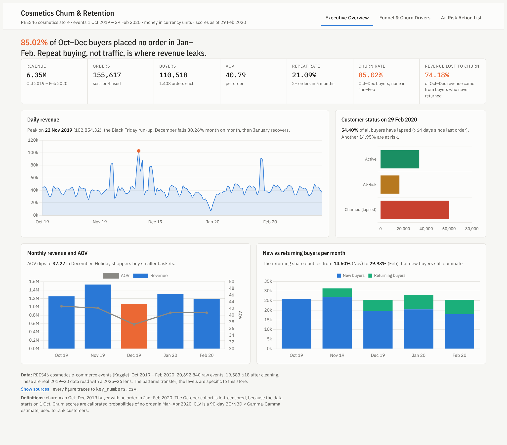
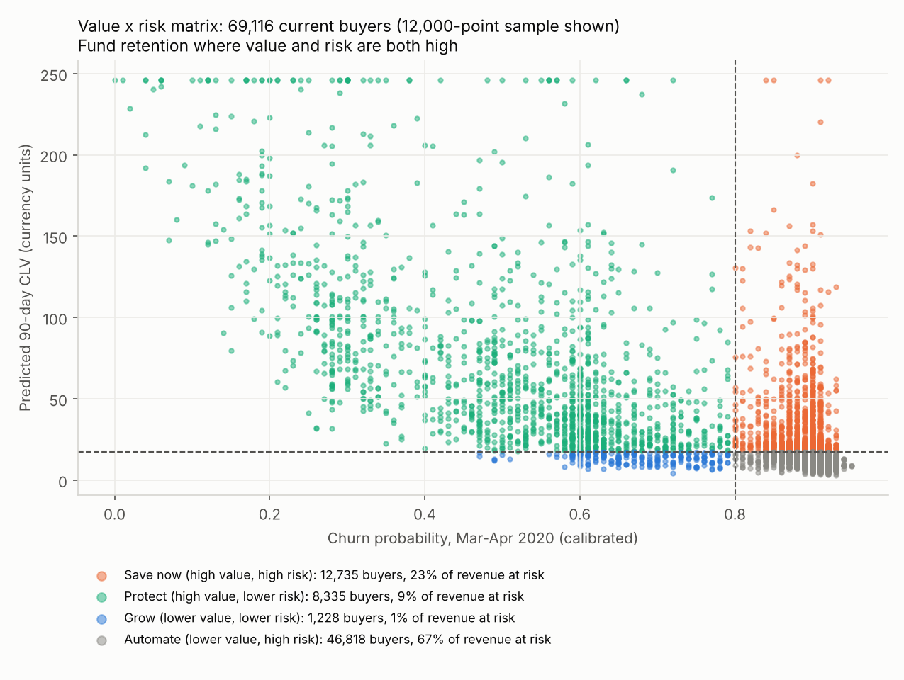
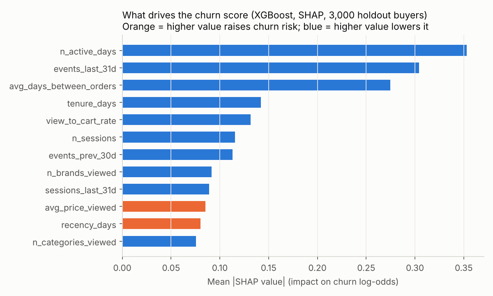
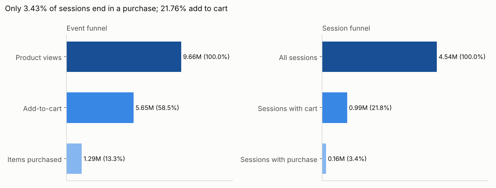
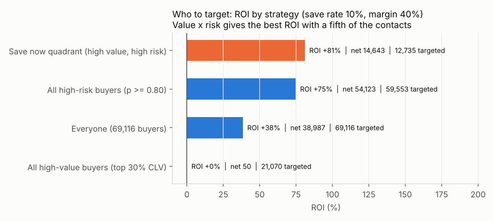

# Customer Churn & Retention Analytics: Cosmetics E-commerce

**Who is about to stop buying, how much revenue is at risk, and which retention actions pay for themselves?**
This is an end-to-end analytics project on real e-commerce data: 20,692,840 clickstream events from the REES46 cosmetics store, Oct 2019 – Feb 2020. It covers SQL validation, churn definition, EDA, statistical testing, churn prediction, customer lifetime value, campaign economics, dashboards and recommendations.

- **Live dashboard:** `<ADD GITHUB PAGES LINK: https://daton-star.github.io/Customer-Churn-Retention-Analytics/>` (served from [`docs/index.html`](docs/index.html); see [Publish the dashboard](#publish-the-dashboard))
- **Stage 1 Kaggle notebook:** `<ADD KAGGLE NOTEBOOK LINK>`
- **Executive summary:** [`reports/executive_summary.md`](reports/executive_summary.md) · **KPI tree and stakeholder map:** [`reports/kpi_tree.md`](reports/kpi_tree.md)

> The data are real 2019–20 events, analysed with 2025–26 business context. Money is in the dataset's **currency units**, not converted. Every number in this repo traces to [`key_numbers/key_numbers.csv`](key_numbers/key_numbers.csv).

[](images/dashboard/01_executive_overview.png)

---

## Headline results
| | |
|---|---|
| Churn (Oct–Dec buyers with no order in Jan–Feb) | **85.02%** of 72,225 buyers [K20, K18] |
| Biggest driver | Single-order buyers churn at 90.37% vs 61.28% for repeat buyers (odds ratio 5.93) [K25, K26, K95] |
| Churn model (XGBoost, chosen on 5-fold CV) | Holdout ROC-AUC **0.7973** vs 0.7293 for an RFM baseline on the same holdout; calibrated tiers within 1 pt [K105, K162, K114] |
| Revenue lost to churn | **74.18%** of Oct–Dec revenue (2,858,778.71 of 3,854,023.56) came from buyers who never returned [K23, K22, K21] |
| Revenue at risk, Mar–Apr 2020 (upper bound) | 3,508,675.24 across 69,116 scored buyers if every at-risk buyer spent like a retained one [K130, K117]. That is 1.41× the store's actual Jan–Feb revenue of 2,494,244.14, so it sizes the prize, not a forecast [K164, K163] |
| Best campaign | Win-back for 12,735 high-value, high-risk buyers: projected **+81.0% ROI** (14,642.53 net on 18,068.63 cost per wave), break-even save rate 4.69% [K132, K135, K136] |
| What not to do | A blanket discount to every high-value buyer only breaks even (+0.1%) [K137] |

## Visual highlights
| Who to save first: value × risk | What drives churn (SHAP) |
|---|---|
|  |  |
| **Where shoppers drop off: view → cart → purchase** | **Which campaign pays back** |
|  |  |

More dashboard pages: [Funnel & Churn Drivers](images/dashboard/02_funnel_churn_drivers.png) · [At-Risk Action List](images/dashboard/03_at_risk_action_list.png)

## Repo structure
```
stage1_kaggle/   Stage 1 (Kaggle): what was produced from the 20.7M raw events + the 11 summary tables (data/)
sql/             DuckDB SQL: 6 validation checks (00) and 15 business queries (01)
src/             Python pipeline p1_…p9_ (one script per phase), config.py (paths), viz_style.py (chart style)
notebooks/       churn_retention_walkthrough.ipynb: narrative walkthrough of the results
outputs/         result tables by phase (CSV / JSON)
images/          charts by phase (PNG), plus dashboard/ page screenshots
dashboard/       index.html (interactive, 3 pages), powerbi/ (star schema + build guide), excel/ (workbook with an ROI what-if sheet)
docs/            copy of the dashboard for GitHub Pages
reports/         phase reports 01–09, executive summary, slide deck outline, career/ (resume, LinkedIn, interview prep)
key_numbers/     key_numbers.csv: the single source for every figure in the deliverables
```

## Method (phase by phase)
| Phase | What | Report |
|---|---|---|
| 1 | Business framing, baseline KPIs, 8 cited benchmarks | [01](reports/01_business_framing.md) |
| 2 | SQL validation (revenue reconciles; churn label re-derived, 72,225 of 72,225 match [K57]) and 15 business queries | [02](reports/02_sql_findings.md) |
| 3 | Churn-definition validation: repurchase gaps, 1/2/3-month windows, false-churn rate 4.01% [K70] | [03](reports/03_churn_definition.md) |
| 4 | EDA and funnel diagnostics: 18 charts, each with a "so what", plus RFM segments | [04](reports/04_eda_funnel.md) |
| 5 | 6 hypothesis tests with effect sizes and Bonferroni correction | [05](reports/05_hypothesis_tests.md) |
| 6 | Churn prediction: logistic regression / Random Forest / XGBoost, stratified CV, PR-AUC, lift, SHAP, calibrated risk tiers | [06](reports/06_churn_prediction.md) |
| 7 | CLV (historical, BG/NBD + Gamma-Gamma with holdout), value × risk, revenue at risk, campaign ROI and sensitivity, A/B design | [07](reports/07_clv_retention_economics.md) |
| 8 | Dashboards: Power BI star schema + 35 DAX measures, interactive HTML, Excel | [08](reports/08_dashboards.md) |
| 9 | 8 prioritised recommendations with owners, KPIs and an impact-vs-effort matrix | [09](reports/09_recommendations.md) |
| 10 | KPI tree and stakeholder question map, resume, LinkedIn post and carousel, interview prep | [KPI tree](reports/kpi_tree.md) · [career/](reports/career/) |

## Reproduce
```bash
python -m venv .venv && source .venv/bin/activate
pip install -r requirements.txt
python run_all.py          # runs phases 1–10 in order (phase 6 model training takes ~12 minutes)
```
All randomness uses fixed seeds (42). `run_all.py` regenerates `outputs/`, `images/`, `dashboard/` and `docs/` from `stage1_kaggle/data/`.
Seven large per-customer CSVs in `outputs/` are not committed (see `.gitignore`); `run_all.py` recreates them. The two large Power BI tables ship as `dashboard/powerbi/large_tables.zip`.

### Publish the dashboard
In the GitHub repo, open **Settings → Pages**, set the source to **Deploy from a branch**, branch `main`, folder `/docs`, and save. The dashboard goes live at `https://<your-username>.github.io/<repo-name>/` within a few minutes. Paste that link at the top of this README.

## Limitations
- **One store, one season** (Oct 2019 – Feb 2020). The patterns transfer; the levels are this store's.
- **Left-censoring:** the October cohort is left-censored, because the data starts on 1 Oct 2019.
- **Missing catalogue data:** brand is missing on 40.38% of revenue, and `category_code` on 98.29% of rows, so the analysis uses `category_id` and brand [K41, K59].
- **Model estimates:** churn scores and CLV are estimates for ranking. BG/NBD over-forecasts post-holiday volume by 29% [K123].
- **Revenue at risk is an upper bound:** it assumes every at-risk buyer would spend like a retained one, which is 1.41× the store's real Jan–Feb revenue [K164]. Use it to rank and size, and quote the historical 74.18% [K23] as the hard number.
- **Repeat-gap evidence is right-censored:** a 5-month window can't observe long repurchase gaps, so "88.43% of repeats within 60 days" [K39] overstates short gaps. The 1- and 3-month sensitivity check [K67, K68] and the 4.01% false-churn rate [K70] cover this.
- **Assumptions:** the campaign economics rest on stated assumptions (contact 0.50, 10% discount, 40% margin) [K134]. They are stress-tested, but only the proposed holdout tests can confirm them.

## Tools
DuckDB (SQL), Python (pandas, scikit-learn, XGBoost, SHAP, lifetimes, SciPy, matplotlib), Power BI (DAX), Excel (openpyxl), HTML/Chart.js.

## Author
Pooja · MBA, IT & Business Analytics · GitHub [Daton-Star](https://github.com/Daton-Star) · LinkedIn `<ADD LINK>`

Data: [REES46 eCommerce events, cosmetics shop (Kaggle)](https://www.kaggle.com/datasets/mkechinov/ecommerce-events-history-in-cosmetics-shop). Used for portfolio and educational purposes.
