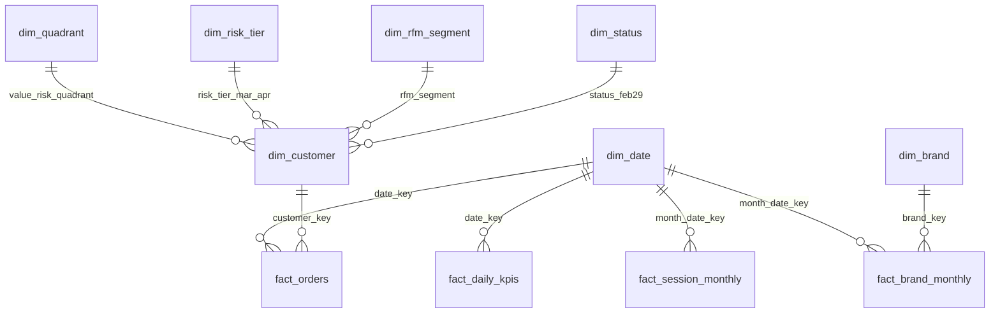

# Power BI Build Guide: Churn & Retention Dashboard

This guide rebuilds the 3-page report from the CSVs in this folder. It takes about an hour in Power BI Desktop (free).
Every expected value below was recomputed from these same CSVs by [p8_verify_measures.py](../../src/p8_verify_measures.py), and its output is in [measure_expected_values.csv](measure_expected_values.csv). Key Numbers ids are in brackets. Money is in **currency units** (the dataset has no currency). Do not format it as ₹ or $.

---

## 1. Files

> **First step:** unzip `large_tables.zip` in this folder. It holds `fact_orders.csv` and `dim_customer.csv`, which are too large to commit directly (or run `python run_all.py` to regenerate them).

| File | Grain | Rows | Role |
|---|---|---|---|
| `fact_orders.csv` | one order | 155,617 [K12] | Fact: revenue, orders, buyers |
| `fact_daily_kpis.csv` | one day | 152 | Fact: views, carts, purchased items, sessions |
| `fact_session_monthly.csv` | month × session-depth bucket | 20 | Fact: cart sessions, abandonment, conversion |
| `fact_brand_monthly.csv` | month × brand | 1,260 | Fact: brand funnel and revenue |
| `dim_customer.csv` | one buyer | 110,518 [K13] | Dimension: status, RFM segment, churn label, churn score, CLV, value × risk quadrant, recommended action |
| `dim_date.csv` | one day, 2019-10-01 to 2020-02-29 | 152 | Date table |
| `dim_brand.csv` | one brand | 274 | Brand tier (Top 10 / Top 11-50 / Long tail / Missing brand) |
| `dim_rfm_segment.csv`, `dim_risk_tier.csv`, `dim_status.csv`, `dim_quadrant.csv` | one label | 3–9 | Sort order for labels (and play / owner for quadrants) |
| `campaign_strategies.csv`, `roi_sensitivity.csv`, `shap_drivers.csv` | scenario / driver | 4–21 | Disconnected tables from Phases 6–7 |
| `theme_churn_retention.json` | | | Report theme (colours match the analysis charts) |

**Key `dim_customer` columns**

| Column | Meaning |
|---|---|
| `status_feb29` | Active (≤38 days since last order), At-Risk (38–64 days), Churned (>64 days), as of 29 Feb 2020 (Phase 3) |
| `in_churn_cohort_oct_dec`, `orders_oct_dec`, `orders_oct_dec_band`, `churned_jan_feb` | Phase 1 churn label: Oct–Dec 2019 buyers with no order in Jan–Feb 2020. Blank for buyers acquired in Jan–Feb. |
| `october_cohort_left_censored` | 1 = first seen in Oct 2019. The data starts on 1 Oct, so some of these are older customers. Their "acquisition month" is not a true first purchase. |
| `rfm_segment`, `rfm_score` | Phase 4 RFM segments (Oct–Dec cohort only) |
| `churn_score_mar_apr`, `risk_tier_mar_apr` | Phase 6 calibrated probability of **no order in Mar–Apr 2020**, for the 69,116 Dec–Feb buyers |
| `clv_90d_predicted`, `p_alive` | Phase 7 BG/NBD × Gamma-Gamma 90-day CLV (use it to rank, not to budget) |
| `revenue_at_risk_mar_apr`, `value_if_retained_60d`, `aov_dec_feb` | Phase 7 revenue at risk = churn probability × value if retained |
| `value_risk_quadrant`, `recommended_action`, `action_owner`, `action_priority_rank` | Phase 7 play per customer. Rank 1 = contact first. |

## 2. Load and model

1. **Get data → Text/CSV** and load every CSV. In Power Query, check these data types:
   - `customer_key`: Whole number
   - every `*_date_key`: Whole number
   - `dim_date[date]`: Date
   - money and score columns: Decimal number
2. **Model view → Mark `dim_date` as date table** on `dim_date[date]`.
3. **Create these relationships.** All are many-to-one, with single cross-filter direction.

| From (many) | To (one) |
|---|---|
| `fact_orders[date_key]` | `dim_date[date_key]` |
| `fact_orders[customer_key]` | `dim_customer[customer_key]` |
| `fact_daily_kpis[date_key]` | `dim_date[date_key]` |
| `fact_session_monthly[month_date_key]` | `dim_date[date_key]` (first day of the month) |
| `fact_brand_monthly[month_date_key]` | `dim_date[date_key]` |
| `fact_brand_monthly[brand_key]` | `dim_brand[brand_key]` |
| `dim_customer[rfm_segment]` | `dim_rfm_segment[rfm_segment]` |
| `dim_customer[risk_tier_mar_apr]` | `dim_risk_tier[risk_tier_mar_apr]` |
| `dim_customer[status_feb29]` | `dim_status[status_feb29]` |
| `dim_customer[value_risk_quadrant]` | `dim_quadrant[value_risk_quadrant]` |



4. **Set Sort by column:**
   - `dim_date[month_name]` and `dim_date[year_month]` by `month_sort`
   - `dim_date[day_of_week]` by `dow_sort`
   - `dim_rfm_segment[rfm_segment]` by `segment_sort`
   - `dim_risk_tier[risk_tier_mar_apr]` by `risk_sort`
   - `dim_status[status_feb29]` by `status_sort`
   - `dim_quadrant[value_risk_quadrant]` by `quadrant_sort`
5. **Hide** all key columns from report view.
6. **View → Themes → Browse** for `theme_churn_retention.json`.

**Why there is no brand on `fact_orders`.** Stage 1 summarises orders without product lines, so an order cannot be split by brand. Brand analysis uses `fact_brand_monthly`, which comes from the event-level funnel. Note that the "unknown" brand carries 40.38% of revenue [K41]. Use category_id and brand, not `category_code`, which is missing on 98.29% of rows [K59].

**Date filtering.** Churn and risk measures live on `dim_customer`. They are customer-level snapshots, so date slicers do not change them. Use **Format → Edit interactions** to switch the date slicer off for those cards.

## 3. DAX measures

Create a blank table `_Measures` (Enter data → one empty column) and add the measures below. The **Expected** column is the value at report level with no filters.

### Sales

```DAX
Total Revenue = SUM ( fact_orders[order_value] )                                   -- 6,348,267.70 [K14]

Total Orders = COUNTROWS ( fact_orders )                                           -- 155,617 [K12]

Buyers = DISTINCTCOUNT ( fact_orders[customer_key] )                               -- 110,518 [K13]

AOV = DIVIDE ( [Total Revenue], [Total Orders] )                                   -- 40.79 [K15]

Orders per Buyer = DIVIDE ( [Total Orders], [Buyers] )                             -- 1.408 [K16]

Repeat Purchase Rate =
VAR RepeatBuyers =
    COUNTROWS (
        FILTER ( VALUES ( fact_orders[customer_key] ), CALCULATE ( COUNTROWS ( fact_orders ) ) >= 2 )
    )
RETURN DIVIDE ( RepeatBuyers, [Buyers] )                                           -- 21.09% [K17]

Revenue Prev Month = CALCULATE ( [Total Revenue], DATEADD ( dim_date[date], -1, MONTH ) )

Revenue MoM % =
DIVIDE ( [Total Revenue] - [Revenue Prev Month], [Revenue Prev Month] )            -- Nov +22.48%, Dec -30.26% [K34]

Cumulative Revenue =
CALCULATE ( [Total Revenue], FILTER ( ALL ( dim_date ), dim_date[date] <= MAX ( dim_date[date] ) ) )

New Buyers = CALCULATE ( [Buyers], fact_orders[is_first_order] = 1 )

Returning Buyers = [Buyers] - [New Buyers]

Returning Buyer Share = DIVIDE ( [Returning Buyers], [Buyers] )                   -- Nov 14.60% -> Feb 29.93% [K36]
```

### Funnel

```DAX
Views = SUM ( fact_daily_kpis[views] )

Carts = SUM ( fact_daily_kpis[carts] )

Purchased Items = SUM ( fact_daily_kpis[purchase_items] )

Cart per View % = DIVIDE ( [Carts], [Views] )                                      -- 58.54% [K28]

Purchase per Cart % = DIVIDE ( [Purchased Items], [Carts] )                        -- 22.75% [K29]

Cart Abandonment % =
DIVIDE (
    SUM ( fact_session_monthly[abandoned_cart_sessions] ),
    SUM ( fact_session_monthly[sessions_with_cart] )
)                                                                                  -- 87.21% [K30]

Session Conversion % =
DIVIDE ( SUM ( fact_session_monthly[sessions_with_purchase] ), SUM ( fact_session_monthly[sessions] ) )  -- 3.43% [K31]
```

### Churn and risk

```DAX
Churn Cohort Buyers =
CALCULATE ( COUNTROWS ( dim_customer ), dim_customer[in_churn_cohort_oct_dec] = 1 )  -- 72,225 [K18]

Churned Buyers = CALCULATE ( COUNTROWS ( dim_customer ), dim_customer[churned_jan_feb] = 1 )  -- 61,403 [K19]

Churn Rate = DIVIDE ( [Churned Buyers], [Churn Cohort Buyers] )                    -- 85.02% [K20]

Active Buyers = CALCULATE ( COUNTROWS ( dim_customer ), dim_customer[status_feb29] = "Active" )   -- 33,871 [K73]

At-Risk Buyers = CALCULATE ( COUNTROWS ( dim_customer ), dim_customer[status_feb29] = "At-Risk" ) -- 16,525 [K74]

Scored Buyers = CALCULATE ( COUNTROWS ( dim_customer ), dim_customer[current_buyer_dec_feb] = 1 ) -- 69,116 [K117]

Expected Churners = SUM ( dim_customer[churn_score_mar_apr] )                      -- 58,597.3 [K142]

Avg Churn Probability = AVERAGE ( dim_customer[churn_score_mar_apr] )

Revenue at Risk = SUM ( dim_customer[revenue_at_risk_mar_apr] )                    -- 3,508,675.25 (K130 = 3,508,675.24 before CSV rounding)

Predicted CLV 90d = SUM ( dim_customer[clv_90d_predicted] )                        -- 1,849,732.41 (K128 = 1,849,732.14 before CSV rounding)

Save-now Buyers =
CALCULATE ( COUNTROWS ( dim_customer ), dim_customer[value_risk_quadrant] = "Save now (high value, high risk)" )  -- 12,735 [K132]
```

### Campaign what-if

Go to **Modeling → New parameter → Numeric range**. Name it `Save Rate`, set min 0.025, max 0.30, increment 0.025 and default 0.10, and tick "Add slicer". This creates `'Save Rate'[Save Rate Value]`.
The assumptions are Phase 7's [K134]: contact cost 0.50 per customer, 10% discount (also paid by customers who would have bought anyway) and 40% gross margin.

```DAX
Save-now Incremental Revenue =
VAR s = [Save Rate Value]
RETURN
    SUMX (
        FILTER ( dim_customer, dim_customer[value_risk_quadrant] = "Save now (high value, high risk)" ),
        s * dim_customer[churn_score_mar_apr] * dim_customer[value_if_retained_60d]
    )

Save-now Campaign Cost =
VAR s = [Save Rate Value]
RETURN
    SUMX (
        FILTER ( dim_customer, dim_customer[value_risk_quadrant] = "Save now (high value, high risk)" ),
        0.10 * dim_customer[aov_dec_feb]
            * ( s * dim_customer[churn_score_mar_apr] + 1 - dim_customer[churn_score_mar_apr] )
            + 0.50
    )

Save-now Net Profit = 0.40 * [Save-now Incremental Revenue] - [Save-now Campaign Cost]   -- 14,642.53 at 10% [K135]

Save-now ROI = DIVIDE ( [Save-now Net Profit], [Save-now Campaign Cost] )               -- +81.0% at 10% [K135]

Save-now Break-even Save Rate =
VAR t = FILTER ( dim_customer, dim_customer[value_risk_quadrant] = "Save now (high value, high risk)" )
VAR Fixed = SUMX ( t, 0.10 * dim_customer[aov_dec_feb] * ( 1 - dim_customer[churn_score_mar_apr] ) + 0.50 )
VAR PerPoint =
    SUMX ( t, 0.40 * dim_customer[churn_score_mar_apr] * dim_customer[value_if_retained_60d]
              - 0.10 * dim_customer[aov_dec_feb] * dim_customer[churn_score_mar_apr] )
RETURN DIVIDE ( Fixed, PerPoint )                                                        -- 4.69% [K136]
```

That is 35 measures. The 15+ required are covered by Sales, Funnel and Churn alone.

**Formatting:**
- Money measures: decimal with thousands separator. Use 2 decimals in tables and "Auto" display units on cards.
- Rate measures: percentage with 2 decimals.
- Probabilities: decimal with 2 decimals.

## 4. Report pages (16:9, 1280 × 720)

### Page 1: Executive Overview
*Question it answers: how big is the business, and how much of it leaks?*

| Position | Visual | Fields |
|---|---|---|
| Top row | 6 cards | Total Revenue, Total Orders, Buyers, AOV, Repeat Purchase Rate, Churn Rate |
| Middle left | Line chart | Axis `dim_date[date]`; values Total Revenue. Add an analytics "max" line, which marks the 22 Nov 2019 peak [K80]. |
| Middle right | Clustered column + line | Axis `dim_date[year_month]`; columns Total Revenue; line Revenue MoM % (secondary axis) |
| Bottom left | Stacked column | Axis `year_month`; values New Buyers, Returning Buyers |
| Bottom middle | Donut | Legend `dim_status[status_feb29]`; values count of `customer_key` (Active / At-Risk / Churned) |
| Bottom right | Card + text box | Revenue at Risk, titled "Revenue at risk (upper bound)" with the caption "If at-risk buyers spent like retained ones; 1.41× actual Jan–Feb revenue [K164]". Format the card in millions (display units: Millions, 2 decimals). |
| Slicer | Dropdown | `dim_date[year_month]`. Edit interactions so it does **not** filter the Churn Rate, status donut or Revenue at Risk. |

**Headline text box:** "85.02% of Oct–Dec buyers did not return in Jan–Feb, and 81.59% of all Oct–Dec buyers had bought only once [K20, K24]."

### Page 2: Funnel & Churn Drivers
*Question it answers: where do shoppers drop out, and what predicts churn?*

| Position | Visual | Fields |
|---|---|---|
| Top left | Funnel | Views, Carts, Purchased Items (three measures in Values) |
| Top middle | Line chart | Axis `year_month`; Cart per View %, Purchase per Cart % |
| Top right | Card pair | Cart Abandonment %, Session Conversion % |
| Bottom left | Column chart | Axis `dim_customer[orders_oct_dec_band]` (1 / 2 / 3 / 4+); value Churn Rate. Shows 90.37% → 33.33% [K48]. |
| Bottom middle | Bar chart | Axis `dim_rfm_segment[rfm_segment]`; values Churn Rate and Churn Cohort Buyers (tooltip) |
| Bottom right | Bar chart | `shap_drivers[feature]` by `mean_abs_shap` (top 10). Title: "What drives the churn score (SHAP)". |
| Optional | Scatter | `fact_brand_monthly` by `dim_brand[brand]`: x = sum of views, y = sum of purchase_items ÷ views, filter `brand_tier` ≠ Missing brand |

**Headline text box:** "Repeat buying is the biggest lever. Single-order buyers have about 6× the odds of churning (+29.09 pp), and silence in the last month adds +15.69 pp."

### Page 3: At-Risk Action List
*Question it answers: who should the retention team contact first, and is it worth it?*

| Position | Visual | Fields |
|---|---|---|
| Left rail | Slicers | `dim_quadrant[value_risk_quadrant]` (default: Save now), `dim_risk_tier[risk_tier_mar_apr]`, `dim_customer[action_owner]`, `Save Rate` slider |
| Top row | 5 cards | Save-now Buyers, Revenue at Risk, Expected Churners, Save-now ROI, Save-now Break-even Save Rate |
| Middle | Scatter | x `churn_score_mar_apr` (don't summarise), y `clv_90d_predicted`, legend `value_risk_quadrant`, details `customer_key`. Add constant lines at x = 0.80 and y = 17.32 [K131]. |
| Bottom | Table | `action_priority_rank`, `customer_key`, `value_risk_quadrant`, `risk_tier_mar_apr`, `churn_score_mar_apr`, `clv_90d_predicted`, `revenue_at_risk_mar_apr`, `orders_oct_feb`, `days_since_last_order`, `recommended_action`, `action_owner`. Sort by `action_priority_rank` ascending. Filter `current_buyer_dec_feb` = 1. |

**Conditional formatting on the table** (Format → Cell elements):
- `churn_score_mar_apr`: background colour, gradient from green (0.30) through amber (0.60) to red (0.95)
- `revenue_at_risk_mar_apr`: data bars, blue
- `days_since_last_order`: font colour by rules. 0–38 green (Active), 38–64 amber (At-Risk), >64 red.
- `value_risk_quadrant`: background by field value from a column with hex codes:
  - Save now `#eb6834`
  - Protect `#1baf7a`
  - Grow `#2a78d6`
  - Automate `#8a8984`

**Headline text box:** "Contact the 12,735 Save-now buyers first. At a 10% save rate the campaign returns +81.0% and breaks even at 4.69%. Use automated, no-discount nudges for everyone else."

**Optional drillthrough page "Customer detail":** drill through on `customer_key`. Show order history from `fact_orders` (date, value, items) and the customer's scores.

## 5. Check before publishing

The report-level values must match [measure_expected_values.csv](measure_expected_values.csv). Specifically:
- Total Revenue 6,348,267.70
- Buyers 110,518
- Churn Rate 85.02%
- Cart Abandonment 87.21%
- Save-now Buyers 12,735
- Save-now ROI +81.0% at the default 10% save rate

If Repeat Purchase Rate shows a different value, check that the date slicer is cleared, because the measure respects the period filter.

## 6. Limitations to state on the report
- The data is from one cosmetics store, Oct 2019 – Feb 2020 (REES46). It is analysed with 2025–26 business context, and the patterns, not the levels, are what transfer.
- The October cohort is left-censored, because the data starts on 1 Oct 2019.
- Churn scores and CLV are model estimates: use them for ranking and tiers, not single-customer verdicts. The campaign economics rest on stated assumptions [K134], and the save-rate slider shows how sensitive they are.
