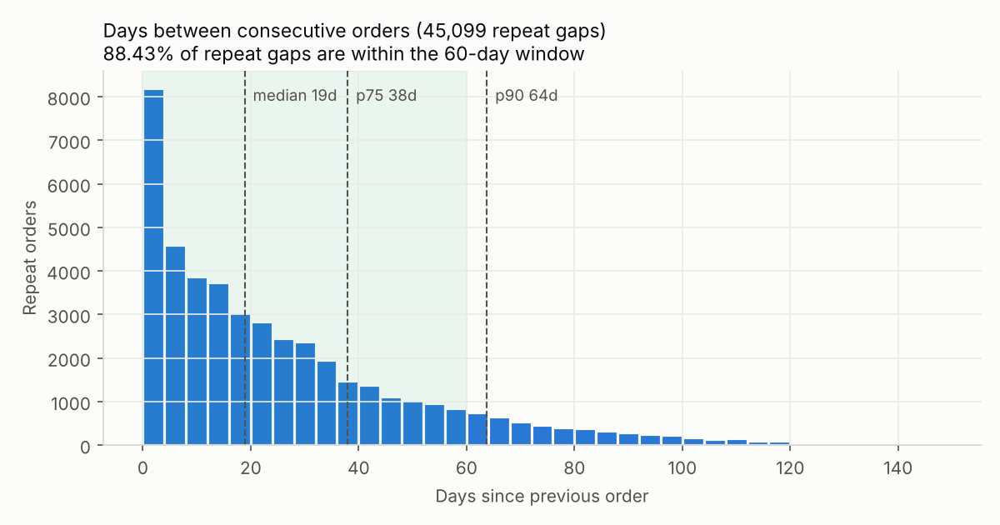
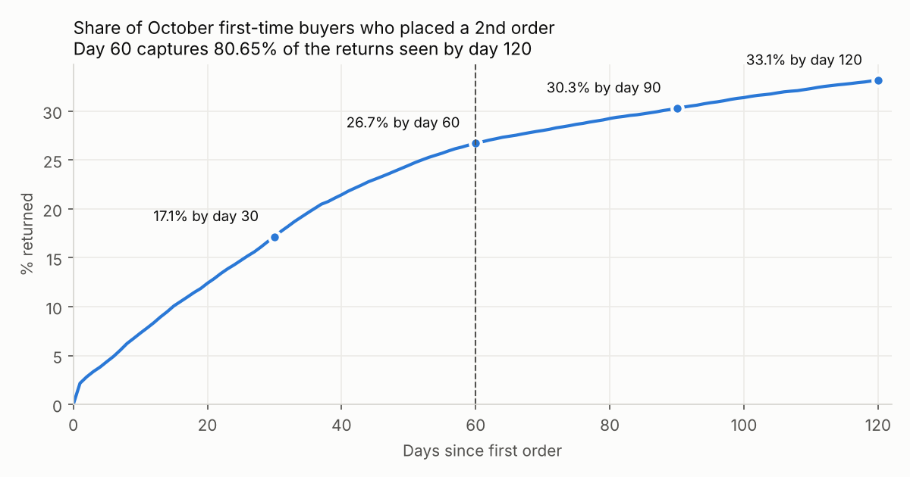
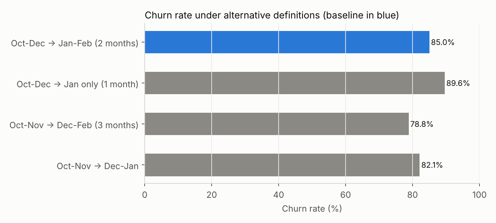
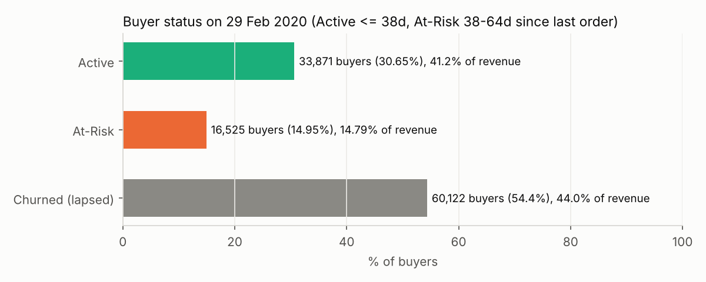

# Phase 3 — Validating the Churn Definition

**Script:** [p3_churn_definition.py](../src/p3_churn_definition.py) (DuckDB + matplotlib, deterministic) · **Results:** [outputs/phase3/](../outputs/phase3/) · **Charts:** [images/phase3/](../images/phase3/)
Numbers cite the Key Numbers table ([key_numbers.csv](../key_numbers/key_numbers.csv)).

**Definition under test:** a customer who bought in Oct–Dec 2019 is **churned** if they place **no order in Jan–Feb 2020** (a 2-month prediction window). Baseline churn is 85.02% [K20].

---

## 1. How long do customers take to come back?

| Gap type | Gaps | Median | p75 | p90 | Within 60 days |
|---|---|---|---|---|---|
| All repeat gaps | 45,099 | 18.9 d | 38.0 d | 63.8 d | 88.43% [K38, K39] |
| 1st → 2nd order | 23,303 | 22.1 d | 45.6 d | 74.5 d | 83.80% [K62, K63] |
| 2nd+ → next order | 21,796 | 16.1 d | 31.2 d | 52.0 d | 93.38% [K64] |

**So what:** most customers who come back do so within a few weeks. The second order takes longest, and established customers repurchase on a tighter cycle.

**Caveat:** gaps measured inside a 5-month window under-count long gaps, because a 150-day gap can't be seen. So the next check uses a curve that doesn't have this bias.

## 2. Time to second order (censoring-safe check)

October first-time buyers all have at least 120 days of follow-up. Of them, 17.15% placed a 2nd order by day 30, 26.72% by day 60, 30.29% by day 90 and 33.13% by day 120 [K65]. **A 60-day window captures 80.65% of the returns seen within 120 days** [K66]. The curve flattens after day 60: the next 60 days add only 6.4 percentage points.

**So what:** if a customer hasn't come back in 2 months, the odds that they ever will drop sharply. That is the business case for treating 60 days as the churn line, and for acting before it.

## 3. Sensitivity check: alternative definitions

| Definition | Cohort | Churn rate |
|---|---|---|
| **A. Baseline: Oct–Dec → Jan–Feb (2 months)** | 72,225 | **85.02%** |
| B. Shorter: Oct–Dec → Jan only (1 month) | 72,225 | 89.59% [K67] |
| C. Longer: Oct–Nov → Dec–Feb (3 months) | 52,523 | 78.83% [K68] |
| D. Same 2 months, shifted: Oct–Nov → Dec–Jan | 52,523 | 82.12% [K69] |

- **Label noise is small.** Of the 43,132 Oct–Nov buyers that a 2-month window calls churned, only 1,730 (**4.01%**) came back in month 3 [K70]. About 96 in 100 "churners" really are gone for at least another month.
- **The drivers hold under every definition.** Single-order buyers churn far more than repeat buyers under the baseline (90.37% vs 61.28%) and under the 3-month definition (84.36% vs 50.69%) [K25, K26, K72]. The ranking of who churns doesn't depend on the window chosen.
- **The level does depend on the window.** Churn ranges from 78.83% to 89.59%, so the headline should be stated as "about 4 in 5 to 9 in 10 buyers don't return within 1–3 months, with 85% on our 2-month definition".

**Limitation of the 2-month window:**
- About 16% of observed second orders take longer than 60 days (100% − 83.80%), so some slow replenishers are labelled churned.
- The window is post-holiday Jan–Feb, which pushes churn up.
- Recency within Oct–Dec matters a lot. Churn is 78.66% for customers whose last order was in December vs 92.10% for October [K71]. So recency must be a model feature (Phase 6), and October churners are the "oldest" lapsers.

## 4. In plain business language
> "We call a customer churned if they bought from us in Oct–Dec but didn't buy again in the next two months. We chose two months because the typical returning customer reorders in about three weeks, and nine out of ten repeat orders happen within 60 days. When we checked whether two months was too short, only about 4 in 100 'churned' customers came back in the third month. Changing the window moves the headline between 79% and 90%, but it never changes *who* is at risk: one-time buyers are always the problem."

## 5. Active / At-Risk / Churned segments (as of 29 Feb 2020)
These thresholds apply to all 110,518 buyers and come from the repeat-gap distribution:

| Status | Rule (days since last order) | Buyers | Revenue share (Oct–Feb) | Action |
|---|---|---|---|---|
| **Active** | ≤ 38 days (p75 gap) | 33,871 (30.65%) | 41.20% | Nurture: cross-sell, loyalty, replenishment reminders [K73] |
| **At-Risk** | 38–64 days (p75–p90) | 16,525 (14.95%) | 14.79% | **Intervene now**: personalised win-back before they lapse [K74] |
| **Churned (lapsed)** | > 64 days (beyond p90) | 60,122 (54.40%) | 44.00% | Low-cost reactivation for high-value lapsers only [K75] |

**So what:** the 16,525 At-Risk buyers are the cheapest group to save. They are past the normal reorder point but not yet beyond the point where most returns stop. Per-user status is in `outputs/phase3/customer_status_by_user.csv`, and the Phase 6 churn scores will refine it.

## Limitations
- Left-censoring: "first-time" October buyers may have bought before Oct 2019, which slightly overstates their return rate.
- Thresholds use all repeat gaps, which mostly come from repeat customers. For one-time buyers, a stricter rule (p75 of 1st→2nd = 45.6 days) would move some At-Risk buyers back into Active.
- The status snapshot uses only purchases; browsing activity is used in Phase 6.

## Phase 3 summary
The 2-month churn window is justified. 88.43% of repeat gaps fall within 60 days, a 60-day window captures 80.65% of 120-day returns, and only 4.01% of 2-month churners return in month 3. The sensitivity check moves churn between 78.83% and 89.59%, but the single-order effect holds under every definition. As of 29 Feb 2020 there are 33,871 Active buyers, 16,525 At-Risk and 60,122 Churned. The At-Risk group is the prime target for retention.
