# Phase 4 — EDA & Funnel Diagnostics

**Script:** [p4_eda.py](../src/p4_eda.py) (DuckDB + matplotlib, deterministic) · **Charts:** [images/phase4/](../images/phase4/) (18) · **Tables:** [outputs/phase4/](../outputs/phase4/) · **Style:** [../src/viz_style.py](../src/viz_style.py)
Numbers cite the Key Numbers table ([key_numbers.csv](../key_numbers/key_numbers.csv)). Money is in currency units, and hours are UTC.

---

## A. Funnel

**1. Overall funnel**
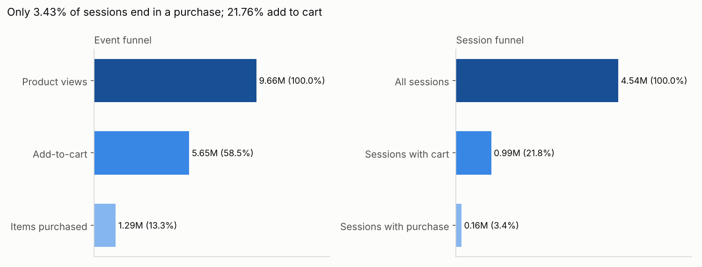
**So what:** only 21.76% of sessions add to cart and 3.43% buy [K76, K31], so the biggest leak is before the cart, not at checkout.

**2. Funnel by month**
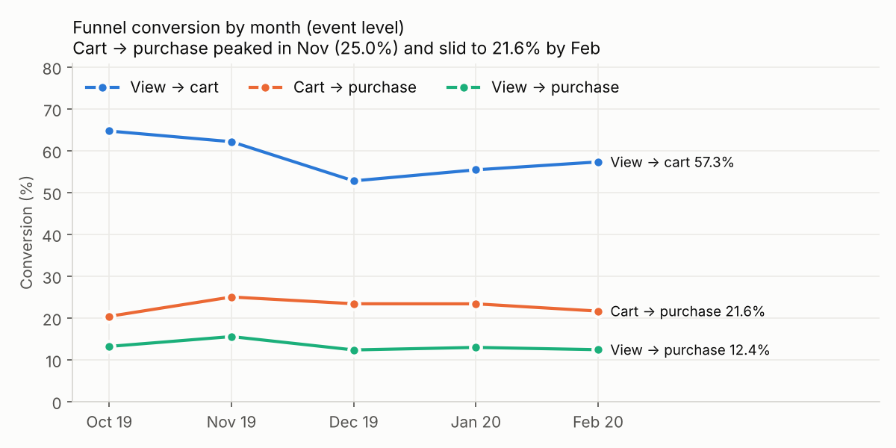
**So what:** cart → purchase peaked in November at 24.99% and slid to 21.62% by February [K78]. View → cart fell from 64.67% to 57.29% [K79]. Post-holiday intent is weaker at both steps.

**3. Daily revenue**
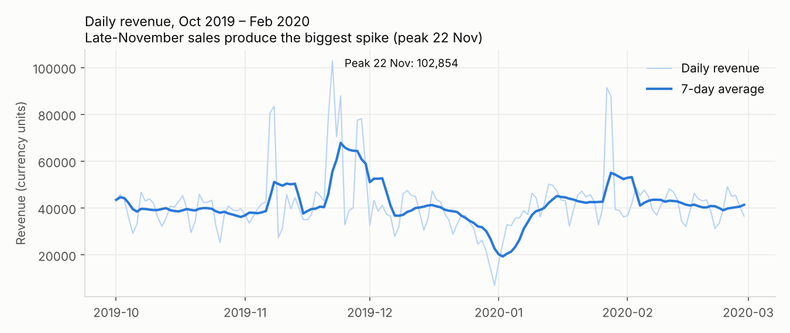
**So what:** the late-November sale period drives the biggest spike (peak 22 Nov, 102,854.32) [K80]. Promotions acquire many customers, but Phase 2 showed those customers churn more.

**4. Brand conversion (15 most-viewed brands)**
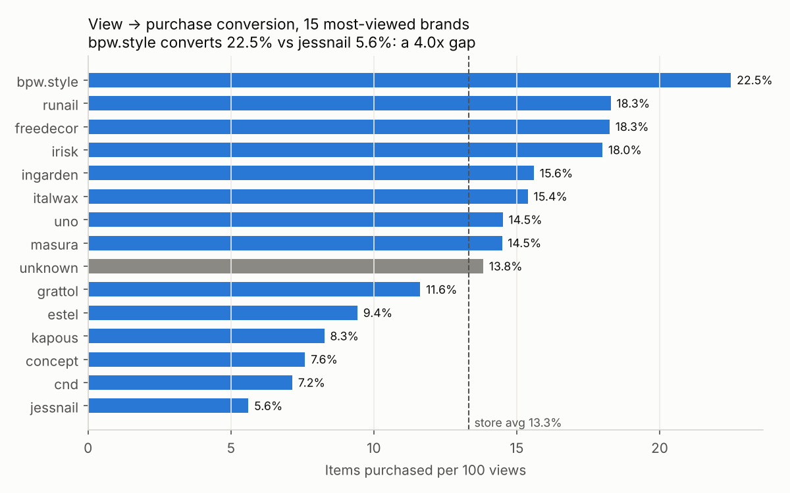
**So what:** view → purchase ranges from 22.50% (bpw.style) to 5.61% (jessnail) against a 13.32% store average [K81, K77]. Low converters need content, price or assortment review.

**5. Where brands leak**
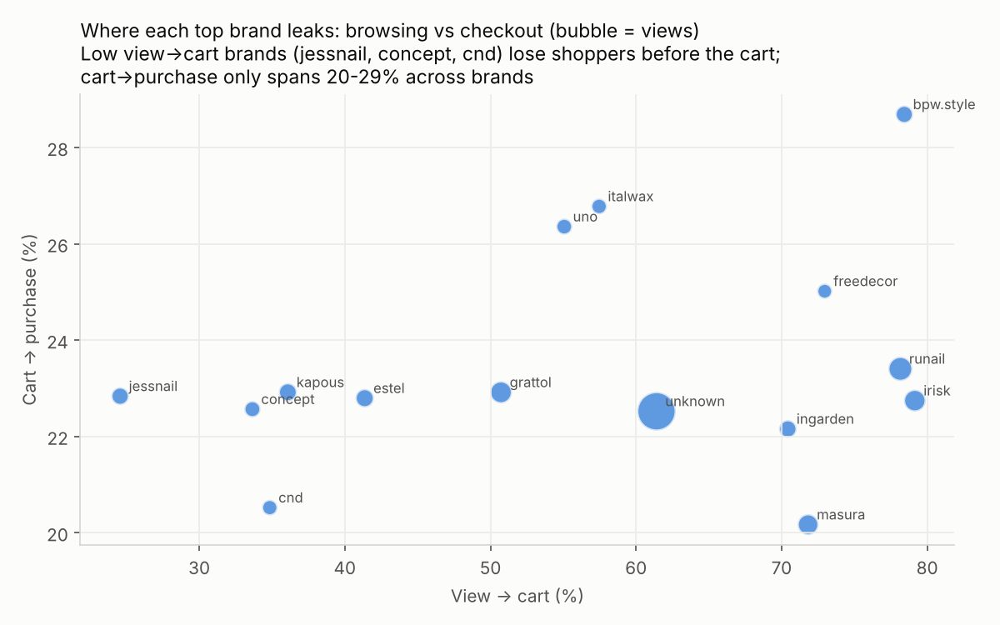
**So what:** brands differ mostly in view → cart (24%–79%), while cart → purchase sits in a narrow 20%–29% band. Brand problems are discovery and product-page problems, not checkout problems.

**6. Category conversion (top 12 by revenue)**
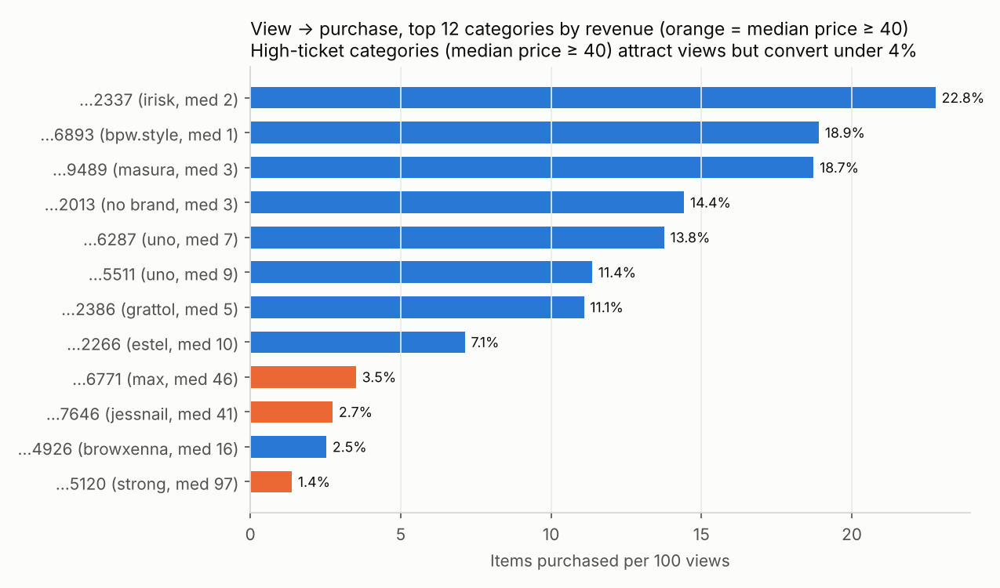
**So what:** high-ticket categories (median price ≥ 40) convert under 4% of views. The #2 revenue category converts only 1.38% at a median price of 97.46 [K61]. Trust signals, reviews and instalment-style offers could unlock it.

**7. Cart abandonment trend**
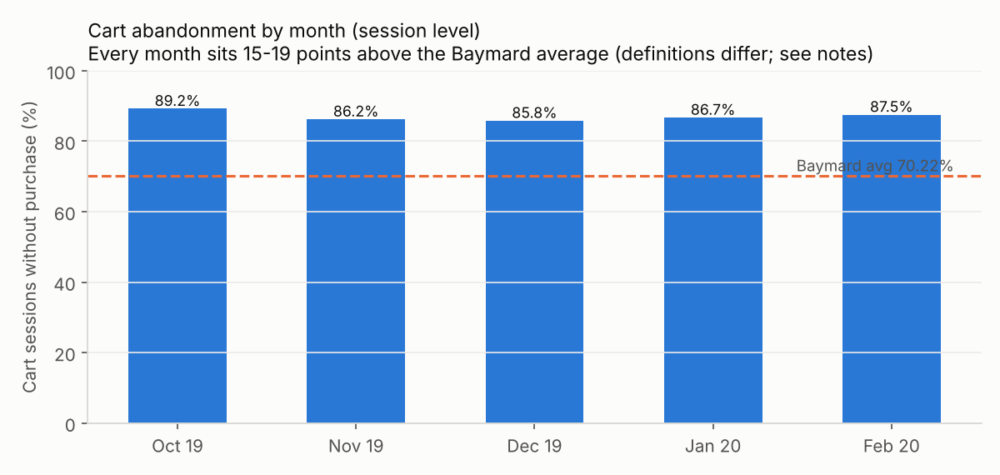
**So what:** session cart abandonment runs 85.83%–89.24% every month and is rising again after December [K45], 15–19 points above Baymard's 70.22% [B1]. That gap is worth an automated cart-recovery flow [B6].
*Caveat:* our metric counts any session with an add-to-cart and no purchase, so it is broader than checkout abandonment and the gap is indicative only.

**8. Session depth vs conversion**
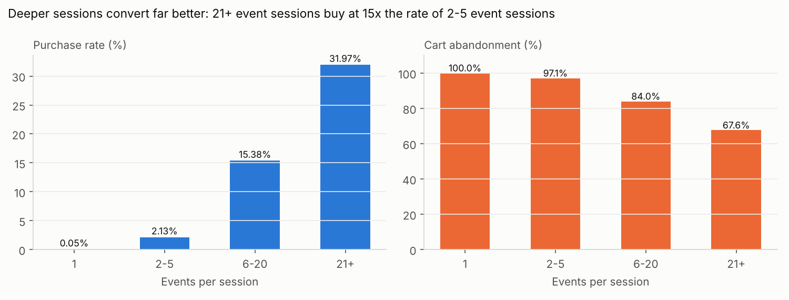
**So what:** single-event sessions are 63.78% of traffic but 0.88% of purchases [K55]. Sessions with 21+ events buy at 31.97% vs 2.13% for 2–5 events [K56]. Recommendations and search that deepen sessions are the conversion lever.

## B. Timing

**9. Revenue by day and hour (UTC)**
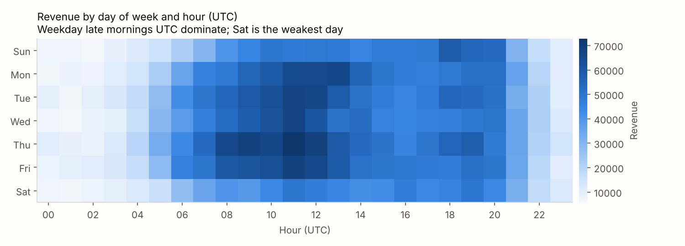
**So what:** weekday late mornings UTC are peak revenue (Thu 11:00 is the top slot [K54]). Thursday is the strongest day (1,018,242.11) and Saturday the weakest (761,185.68) [K82]. Schedule campaigns for weekday mornings.

**10. Traffic vs conversion by hour**
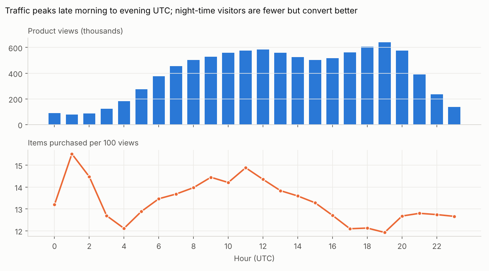
**So what:** night-time (UTC) visitors are few but convert best (15.52% at 01:00 vs 11.93% at 19:00) [K83]. They are high-intent shoppers, so evening traffic needs nudges like reminders and saved carts.

## C. Retention cohorts

**11. Visitor cohorts**
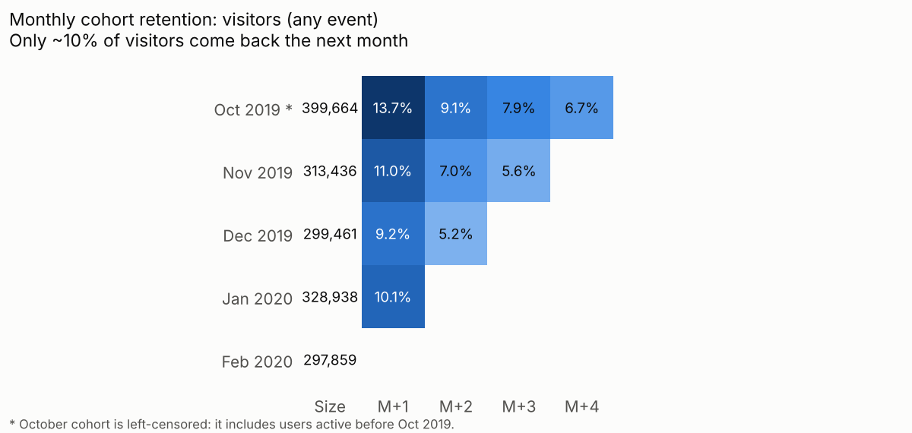
**So what:** only 9%–11% of new visitors return the next month (Nov–Jan cohorts) [K84]. Traffic is mostly one-off, so re-engagement has to start on the first visit (capture email, WhatsApp or push opt-in).

**12. Buyer cohorts**
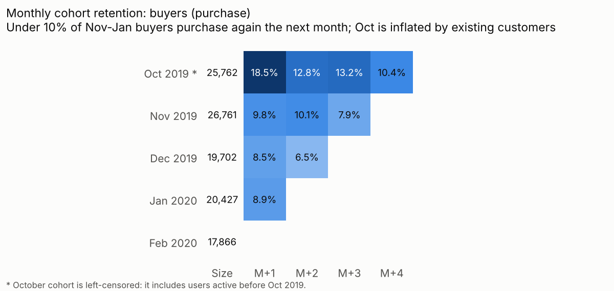
**So what:** under 10% of Nov–Jan first-time buyers buy again the next month (9.78%, 8.52%, 8.86%) [K85]. That is the first-to-second-order gap to close.
*Flag:* October's 18.49% is inflated by left-censoring, because it includes customers who bought before Oct 2019.

## D. Customer value

**13–14. RFM segmentation** (Oct–Dec behaviour, snapshot 1 Jan 2020, joined to Jan–Feb churn)

R = recency quintile, F = order-count bands (1, 2, 3, 4–5, 6+), M = spend quintile. Segments use the standard R × F map. Ties are broken by user_id so results are reproducible.

| Segment | Rule | Buyers | Revenue share | Churn | Churn share |
|---|---|---|---|---|---|
| Champions | R4–5, F4–5 | 1,545 (2.14%) | 9.86% | 28.67% | 0.72% [K86] |
| Loyal | R3–5, F3+ | 2,508 (3.47%) | 9.90% | 47.57% | 1.94% [K87] |
| Potential Loyalists | R4–5, F2 | 4,534 (6.28%) | 9.57% | 65.95% | 4.87% [K88] |
| Recent One-timers | R4–5, F1 | 21,094 (29.21%) | 19.59% | 88.82% | 30.51% [K89] |
| Need Attention | R3, F1–2 | 13,654 (18.90%) | 16.83% | 86.29% | 19.19% [K90] |
| Can't Lose Them | R1–2, F4+ | 80 (0.11%) | 0.47% | 92.50% | 0.12% [K91] |
| At Risk | R1–2, F2–3 | 2,513 (3.48%) | 6.38% | 80.02% | 3.28% [K91] |
| Hibernating | R2, F1 | 12,634 (17.49%) | 13.04% | 91.13% | 18.75% [K92] |
| Lost | R1, F1 | 13,663 (18.92%) | 14.37% | 92.67% | 20.62% [K92] |

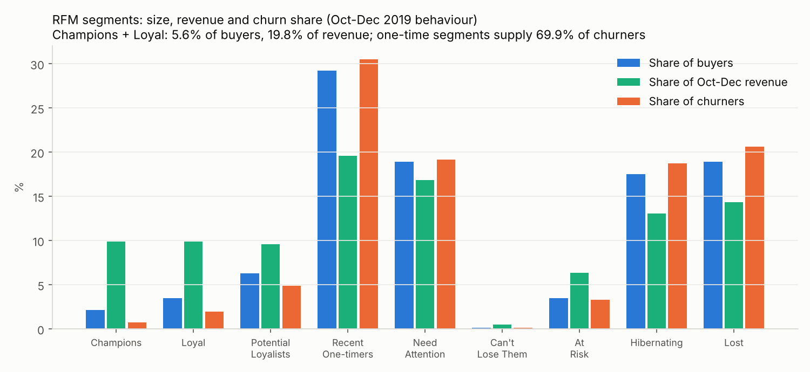
**So what:** Champions + Loyal are 5.6% of buyers but 19.8% of revenue, and they rarely churn. Protect them with loyalty perks, not discounts.

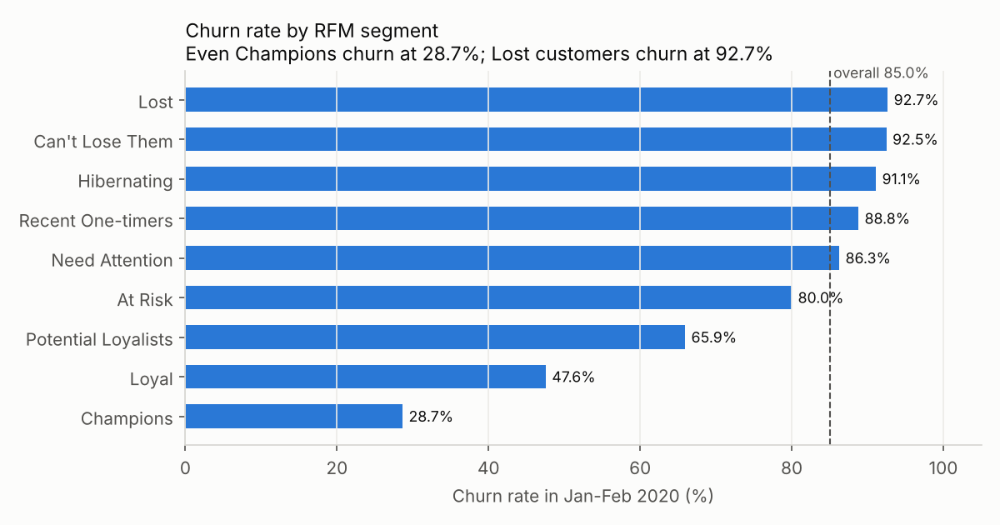
**So what:** **Recent One-timers** (21,094 buyers, 30.51% of churners) are the best retention target. They bought recently, so a second-order nudge reaches them while intent is fresh. Lost and Hibernating customers churn at over 91%, so only low-cost reactivation pays off there.

**15. Pareto**
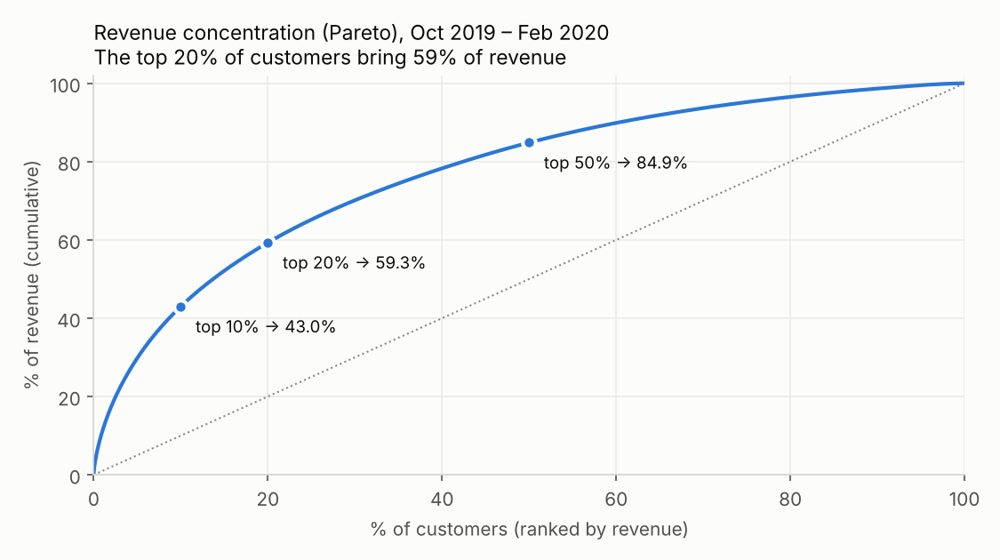
**So what:** the top 10% of customers bring 43.00% of revenue and the top 20% bring 59.31% [K53]. Retention spend should be weighted by value (Phase 7).

**16. December holiday-cohort quality**
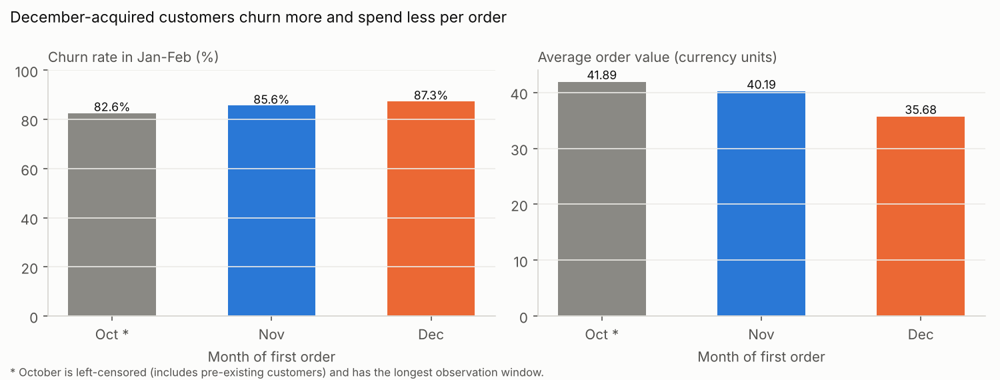
**So what:** customers acquired in December churn at 87.34% vs 85.63% for November, with lower AOV (35.68 vs 40.19) [K46, K47]. Only 7.04% of them repeated within Oct–Dec vs 16.79% for November [K93].
*Caveat:* December buyers also had less time to repeat. Phase 5 tests whether the churn gap is significant.

## E. Churn drivers

**17. Churn by number of orders**
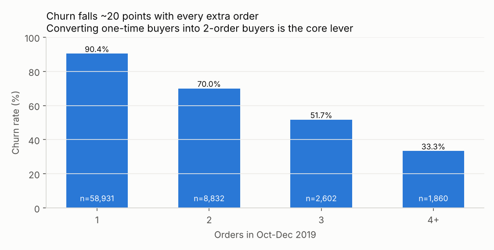
**So what:** churn drops about 20 points per extra order (90.37% → 70.00% → 51.69% → 33.33%) [K48]. The second order is the single biggest retention lever.

**18. Churn by recent engagement**
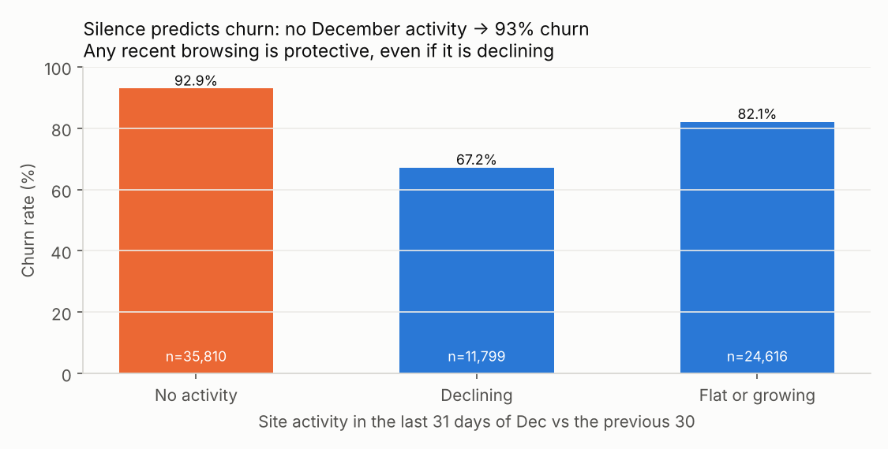
**So what:** buyers with no site activity in their last 31 days churn at 92.93% vs 67.17% for declining-but-active buyers [K50, K51]. Trigger re-engagement when a customer goes silent, not when activity merely dips.

## Phase 4 summary
The funnel leaks mostly before the cart. 63.78% of sessions are single-event bounces, and brand conversion differs at view → cart rather than at checkout. Retention is weak from the first visit: under 10% of new buyers return the next month, and December-acquired customers are lower value. RFM shows Recent One-timers (21,094 buyers, 30.51% of churners) as the best target, while Champions and Loyal (5.6% of buyers, 19.8% of revenue) need protection. All 18 charts have a one-line "so what", and every figure is in the Key Numbers table (93 entries).
