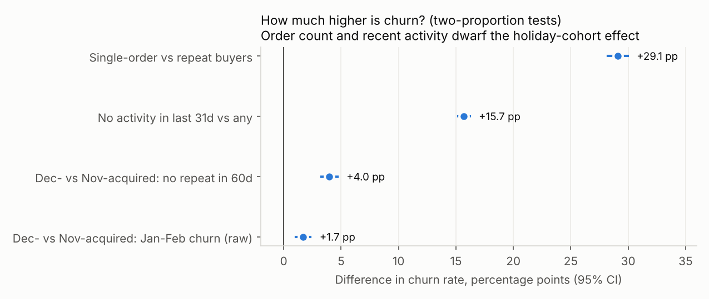
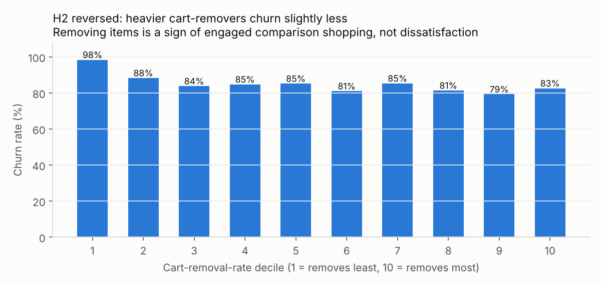

# Phase 5 — Statistical Testing

**Script:** [p5_hypothesis_tests.py](../src/p5_hypothesis_tests.py) (scipy, deterministic) · **Results:** [outputs/phase5/hypothesis_results.csv](../outputs/phase5/hypothesis_results.csv) · **Charts:** [images/phase5/](../images/phase5/)
**Population:** the 72,225 Oct–Dec 2019 buyers (churn = no order in Jan–Feb 2020) unless stated. α = 0.05 with Bonferroni correction across 6 tests. Numbers cite [key_numbers.csv](../key_numbers/key_numbers.csv).

**Reading the results:** with tens of thousands of customers, almost any difference is "significant". So every result is judged by its **effect size** (Cramér's V, Cohen's h, rank-biserial r, ε²) and its size in business terms. The p-value alone doesn't decide anything.

---

## Summary table
| # | Hypothesis | Test | Result | p (Bonferroni) | Effect size | Verdict |
|---|---|---|---|---|---|---|
| H1 | Single-order buyers churn more | Chi-square 2×2 + two-proportion z | 90.37% vs 61.28%: **+29.09 pp** [28.23, 29.95], odds ratio 5.93 | < 1e-300 | V = 0.316 (medium) | **Supported** [K95] |
| H2 | Heavy cart-removers churn more | Mann-Whitney U | Median removal rate 0.350 (churned) vs 0.467 (retained) | 1.0e-161 | r = −0.163 (small) | **Rejected: reversed** [K96] |
| H3 | December (holiday) buyers retain worse | Two-proportion z, recency-free window | No 2nd order in 60 days: 84.41% (Dec) vs 80.43% (Nov): **+3.98 pp** [3.29, 4.68] | 1.1e-27 | h = 0.105 (negligible) | **Supported, but small** [K98] |
| H4 | No activity in the last 31 days predicts churn | Chi-square 3×2 + two-proportion z | 92.93% vs 77.24%: **+15.69 pp** [15.18, 16.20], odds ratio 3.87 | < 1e-300 | V = 0.260 (small–medium) | **Supported** [K99] |
| H5 | Churners had lower order values | Mann-Whitney U | Median AOV 26.66 vs 37.15 | 1.9e-198 | r = −0.181 (small) | **Supported, small** [K100] |
| H6 | First-basket value differs by acquisition month | Kruskal-Wallis + pairwise Mann-Whitney | Median first order: Oct* 29.99, Nov 28.92, Dec 24.47 | 1.8e-92 | ε² = 0.006 (negligible) | **Statistically yes, practically no** [K101] |

**So what:** order count (+29 pp) and recent inactivity (+16 pp) are the big churn drivers. The holiday-cohort effect is real but small (+4 pp).

---

## Details and business meaning

### H1: Single-order buyers churn more than repeat buyers
- **H₀:** churn is the same for single-order and repeat buyers. **H₁:** single-order buyers churn more.
- **Why this test:** two groups with a binary outcome → chi-square on the 2×2 table. The two-proportion z-test gives the difference with a confidence interval.
- **Result:** 90.37% (n = 58,931) vs 61.28% (n = 13,294). The difference is 29.09 pp (95% CI 28.23–29.95), relative risk is 1.47 and the odds ratio is 5.93.
- **Business meaning:** a one-time buyer has about 6× the odds of churning. **The second purchase is the moment to fund.** A post-first-order journey (replenishment reminder, a "complete your routine" cross-sell, a small second-order incentive) targets the largest and most fixable gap.

### H2: Buyers who remove more items from their cart churn more
- **Why this test:** removal rate is skewed and bounded, so the rank-based Mann-Whitney U is used rather than a t-test. Effect size is the rank-biserial correlation.
- **Result:** churners remove *less* (median 0.350 vs 0.467, r = −0.163, n = 71,568 with any cart activity). The direction holds within single-order buyers (r = −0.143) and within repeat buyers (r = −0.057).
- **Where it comes from:** the lowest decile (no removals at all) churns at 98.35% [K97]. These are buyers who added once and checked out, then never came back.

- **Business meaning:** cart removal is engaged comparison shopping, not dissatisfaction. **Don't trigger churn alerts on cart removals.** Cart *abandonment* (sessions that end without purchase) is a separate conversion problem, handled with cart-recovery flows.

### H3: December (holiday) acquired buyers retain worse
- **Design choice:** comparing Jan–Feb churn directly is confounded. December buyers bought more recently, and for one-time buyers the acquisition month *is* the recency. So the test uses a window anchored on each buyer's own first order: **"no second order within 60 days of the first order"**. Every Nov and Dec first-time buyer has at least 60 days of follow-up. October is excluded because it is left-censored.
- **Result:** 84.41% of Dec-acquired buyers (n = 19,702) vs 80.43% of Nov-acquired buyers (n = 26,761) did not repeat within 60 days: +3.98 pp (CI 3.29–4.68), relative risk 1.05, h = 0.105. For comparison, the raw Jan–Feb churn gap is only +1.71 pp, because the recency confound hides part of the effect.
- **Business meaning:** holiday-acquired buyers are a slightly weaker cohort, but this is not the main churn driver. A tailored January follow-up for gift-season buyers is worth testing. The bigger lever remains H1, which applies to all cohorts.

### H4: No site activity in the last 31 days predicts churn
- **Why this test:** three engagement groups (no activity / declining / flat or growing) × churn → chi-square with Cramér's V. Then "none vs any" with a z-test for a usable effect.
- **Result:** churn is 92.93% with no activity (n = 35,810), 67.17% for declining and 82.06% for flat or growing. None vs any: +15.69 pp, odds ratio 3.87.
- **Business meaning:** silence is the warning sign. "Declining but still visiting" customers churn *least*, probably because they are between purchases. **Trigger re-engagement when a buyer has had no visit for about 30 days**, not when activity merely dips.

### H5: Churners had lower average order value
- **Result:** median AOV 26.66 (churned) vs 37.15 (retained), r = −0.181 (small).
- **Business meaning:** bigger baskets go with retention, but the effect is modest. Basket-building tactics (bundles, free-shipping thresholds) help at the margin. The churn model needs behaviour (orders, recency, activity), not just spend.

### H6: First-order basket value differs by acquisition month
- **Why this test:** three independent groups, skewed values → Kruskal-Wallis, with pairwise Mann-Whitney U and a Bonferroni correction (×3).
- **Result:** Dec buyers start with smaller baskets (median 24.47 vs 28.92 Nov), but ε² = 0.006 and the largest pairwise effect (Oct vs Dec) is r = 0.108.
- **Business meaning:** holiday buyers don't arrive dramatically "cheaper". Their weaker retention (H3) shows up *after* the first order, so the response is a follow-up journey, not acquisition targeting.

---

## Limitations
- These are observational associations, not causal effects. Only the A/B test designed in Phase 7 can prove that a second-order campaign *causes* lower churn.
- The October cohort is left-censored and excluded from H3. The H6 October median is reported but flagged.
- Huge samples make p-values tiny, so the decisions rest on effect sizes and the pp differences above.

## Phase 5 summary
Four of six hypotheses are supported, one is reversed and one is negligible in practice. Single-order buyers have about 6× the odds of churning (+29.09 pp), and no site activity in the last 31 days adds +15.69 pp. Both are the biggest effects and the priority triggers for retention. Heavy cart-removers actually churn *less*, so removals shouldn't drive alerts. December-acquired buyers repeat slightly less within 60 days (+3.98 pp, negligible effect size), which justifies a light post-holiday follow-up rather than a major programme.
