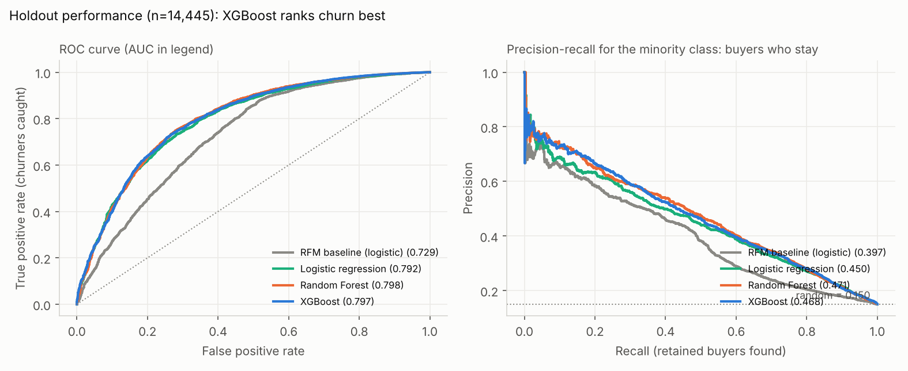
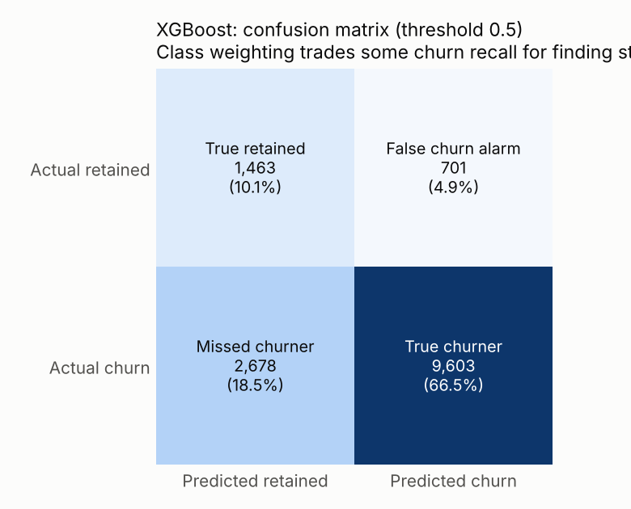
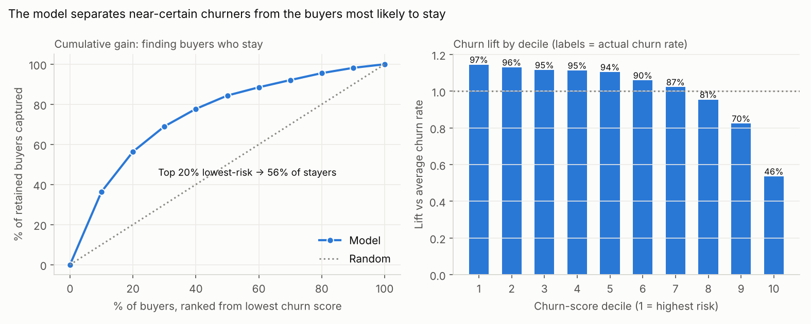
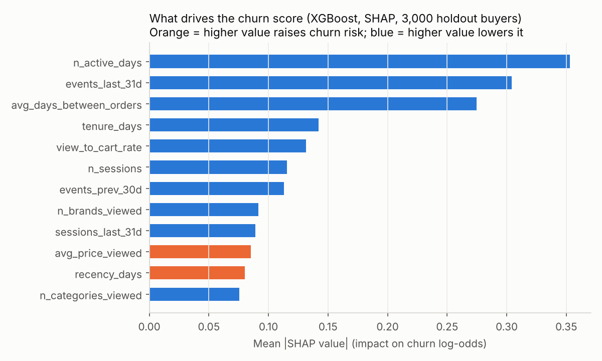
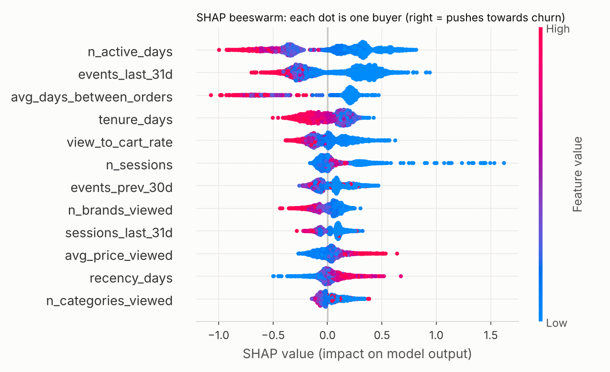
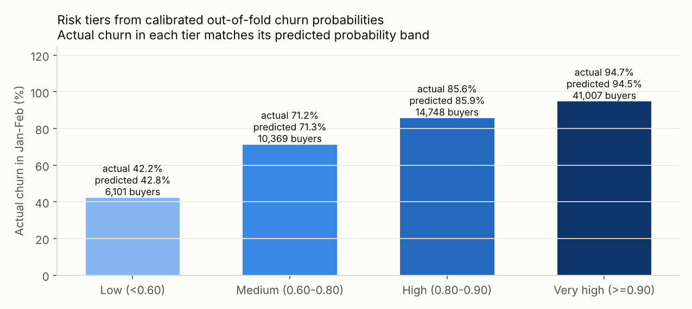

# Phase 6 — Churn Prediction

**Script:** [p6_churn_model.py](../src/p6_churn_model.py) (scikit-learn 1.9, XGBoost 3.4, SHAP 0.54; seed 42 throughout) · **Results:** [outputs/phase6/](../outputs/phase6/) · **Charts:** [images/phase6/](../images/phase6/)
**Data:** `user_churn_features.csv`, with 72,225 Oct–Dec 2019 buyers and the label "no order in Jan–Feb 2020". Numbers cite [key_numbers.csv](../key_numbers/key_numbers.csv).

---

## 1. Setup and leakage control
- **Excluded from features:** `future_orders`, `future_spend` and `churned` (all label-window columns), all four timestamps, and `user_id`. The script asserts that none of them enter the model.
- **Features (41) [K103]:** 29 behavioural columns from the observation window (activity, funnel ratios, orders, spend, recency, tenure, last-31-day vs previous-30-day engagement), top-10 purchased-brand flags, and missing-value flags. Missing values mean "never viewed" or "never carted"; single-order buyers get −1 for the gap feature.
- **Validation:** a stratified 80/20 holdout (57,780 train / 14,445 test) plus 5-fold stratified CV on the training set. **The model is chosen on CV**, so the holdout stays an unbiased final check.
- **Class imbalance:** churn is the *majority* class (85.02%). The hard part is finding the 15% who stay. This is handled with `class_weight="balanced"` (logistic regression, Random Forest) and `scale_pos_weight` (XGBoost), and both classes' PR-AUC are reported.

## 2. Model comparison (5-fold CV on train)
| Model | ROC-AUC | PR-AUC (retained, baseline 0.15) |
|---|---|---|
| RFM baseline (logistic on recency, orders, spend) | 0.7151 ± 0.0078 | 0.3932 |
| Logistic regression (all features) | 0.7877 ± 0.0046 | 0.4538 |
| Random Forest | 0.7919 ± 0.0059 | 0.4729 |
| **XGBoost (selected)** | **0.7932 ± 0.0059** | **0.4755** |
[K104]. Behavioural features add about 0.08 AUC over RFM alone. The three full models are close, and XGBoost edges ahead on both metrics.

## 3. Holdout performance (XGBoost, n = 14,445)
| Metric | XGBoost | Naive "everyone churns" |
|---|---|---|
| ROC-AUC | **0.7973** | 0.50 |
| PR-AUC, churn class | 0.9486 | 0.8502 |
| PR-AUC, retained class | **0.4682** | 0.1498 |
| Accuracy | 76.61% | **85.02%** |
| Churn: precision / recall / F1 | 0.932 / 0.782 / 0.850 | 0.850 / 1.000 / 0.919 |
| Retained: precision / recall / F1 | 0.353 / 0.676 / 0.464 | 0 / 0 / 0 |
| Precision @ top 10% / 20% churn scores | 97.30% / 96.68% | 85.02% |
| Actually stayed, among the 10% lowest scores | **54.50% (lift 3.64×)** | 14.98% |
[K105–K111]

**Why accuracy alone misleads:** a model that predicts "everyone churns" scores **85.02% accuracy**, higher than our model's 76.61% [K108], but it finds zero of the customers worth keeping and can't rank anyone. With imbalanced classes, accuracy rewards guessing the majority. ROC-AUC (ranking quality), PR-AUC for the minority class, and precision@k (how pure the target list is) measure what the business needs.

**Confusion matrix (threshold 0.5) [K109]:** 9,603 churners caught, 2,678 missed, 701 false alarms and 1,463 stayers correctly identified. The class weighting deliberately trades some churn recall for finding two-thirds of stayers.

**Lift and gain:**

- The top two churn deciles are 97% and 96% churners. Precision@top-k for churn is near its ceiling because the base rate is already 85%.
- The real value is at the other end. The 20% lowest-risk buyers contain **56.38% of all buyers who stay** [K111]. That is where retention money has the best odds, as Phase 7 will show.

## 4. SHAP explanations (what drives the score)

| Driver (rank) | In business language |
|---|---|
| 1. `n_active_days` | Customers who visited on more distinct days are far less likely to churn. Habit is the strongest protection. |
| 2. `events_last_31d` | Activity in the final month is protective, and silence pushes the score up. This matches Phase 5, H4. |
| 3. `avg_days_between_orders` | Having *any* repeat order (and a short cycle) cuts risk sharply. Single-order buyers (−1) sit on the high-risk side. This matches H1. |
| 4. `tenure_days` | Longer-standing customers churn less. Newly acquired buyers are fragile. |
| 5. `view_to_cart_rate` | Shoppers who add what they view to the cart are more committed. |
| `recency_days`, `avg_price_viewed` | A longer time since the last order and browsing expensive items (high-ticket "window shopping") raise risk. |
| `cart_remove_rate` | Once activity is controlled for, a higher removal rate slightly *raises* risk. The opposite raw pattern in Phase 5 (H2) came from removers simply being more active. |

[K112]. *SHAP is computed on 3,000 holdout buyers with TreeExplainer. It explains the model's associations, not causes.*

## 5. Risk tiers (calibrated)
Class weighting distorts raw scores, so the model is wrapped in **isotonic calibration**. Every buyer gets an **out-of-fold** probability (calibrated OOF ROC-AUC 0.7956, Brier 0.1015) [K113].

| Tier | Rule | Buyers | Predicted | Actual churn | Share of Jan–Feb spend |
|---|---|---|---|---|---|
| Low | p < 0.60 | 6,101 | 42.8% | 42.2% | 48.04% |
| Medium | 0.60–0.80 | 10,369 | 71.3% | 71.2% | 24.62% |
| High | 0.80–0.90 | 14,748 | 85.9% | 85.6% | 14.40% |
| Very high | ≥ 0.90 | 41,007 | 94.5% | 94.7% | 12.94% |
[K114, K115]

**So what:** predicted and actual churn match within 1 point in every tier, so the probabilities can be used directly in revenue-at-risk maths. The Low and Medium tiers are only 22.8% of buyers but generate 72.66% of next-period spend. These are the customers worth saving. The Very-high tier, 57% of buyers, gets low-cost automated nudges only.

## 6. Who will churn next? (scoring current buyers)
The full model uses browsing features that exist only for Oct–Dec. To score customers *today* (29 Feb 2020), a **deployment model** uses order-history features only (recency, tenure, orders, spend, AOV, items, brands per order, repeat gap, orders in the last 31 days). These can be recomputed for any window.
- It is trained on Oct–Dec → Jan–Feb and isotonic-calibrated. CV ROC-AUC is **0.7348 ± 0.0048** [K116]: below the full model (it has no browsing signal) but above the RFM baseline.
- It is applied to the **Dec 2019 – Feb 2020** window, the same 3-month length, to predict **no order in Mar–Apr 2020**.
- **69,116 current buyers scored. Expected churners: 58,632.95 (84.83%)** [K117], in line with the historical rate.

| Tier (Mar–Apr risk) | Buyers | Dec–Feb spend |
|---|---|---|
| Low (< 0.60) | 5,693 | 921,088.14 |
| Medium (0.60–0.80) | 3,941 | 304,759.09 |
| High (0.80–0.90) | 20,864 | 1,123,095.29 |
| Very high (≥ 0.90) | 38,618 | 1,214,516.23 |
[K118]. The per-buyer list is in [current_buyers_churn_scores_mar_apr.csv](../outputs/phase6/current_buyers_churn_scores_mar_apr.csv) and feeds the Phase 7 value × risk matrix and the Phase 8 at-risk action list.

## Limitations
- One store and one prediction window (post-holiday Jan–Feb). Performance may drift in other seasons, so retrain monthly.
- The deployment model is applied to a window that includes the holidays only partly (Dec). Its calibration on the new window can't be verified until Mar–Apr outcomes exist, so it should be monitored.
- AUC of about 0.80 means real ranking power, but individual predictions are uncertain. Use tiers and lists, not single-customer verdicts.
- SHAP shows associations. The causal effect of interventions is measured with the Phase 7 A/B test.

## Phase 6 summary
XGBoost (chosen on 5-fold CV) reaches a holdout ROC-AUC of 0.7973 and a retained-class PR-AUC of 0.4682, against baselines of 0.50 and 0.15. It beats an RFM-only model by about 0.08 AUC. Accuracy is misleading here, because "everyone churns" scores 85.02%. Habit (active days), recent activity and a second order drive the score. Calibrated tiers match actual churn within 1 point, and the Low and Medium tiers (22.8% of buyers) hold 72.66% of next-period spend. An orders-only deployment model scores all 69,116 current buyers for Mar–Apr 2020 and expects 58,632.95 churners, ready for the Phase 7 economics.
