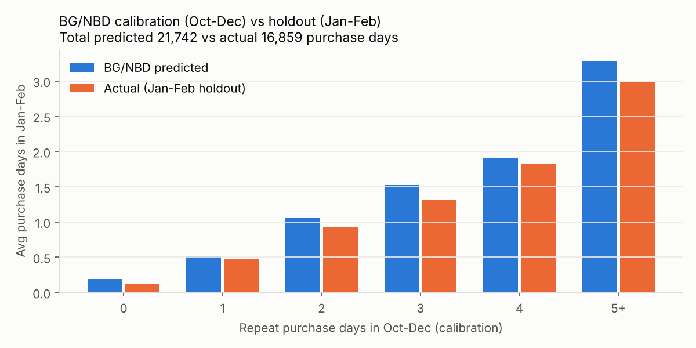
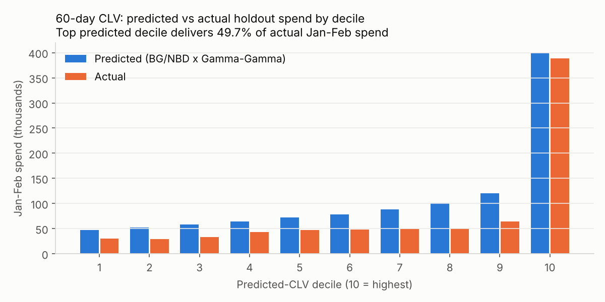
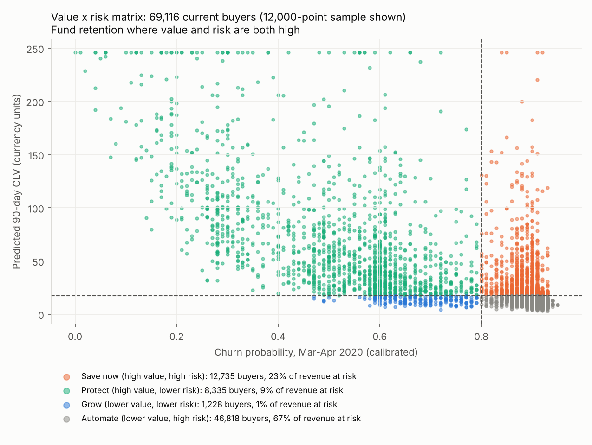
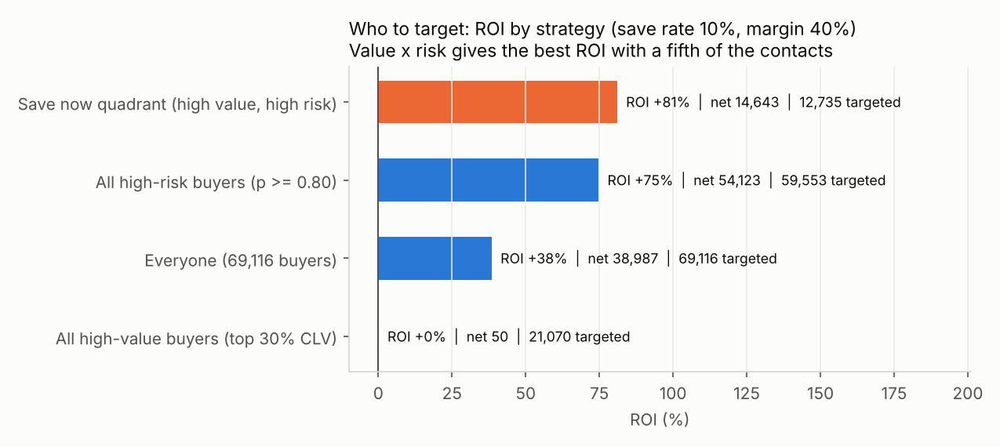
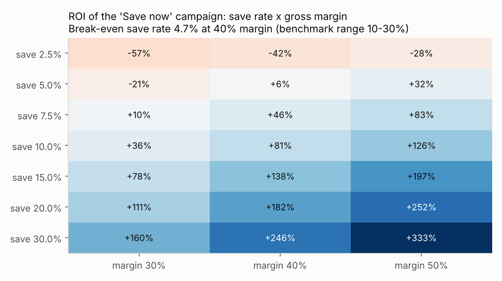

# Phase 7 — Customer Value & Retention Economics

**Script:** [p7_clv_economics.py](../src/p7_clv_economics.py) (lifetimes 0.11 BG/NBD + Gamma-Gamma, pandas, scipy; deterministic) · **Results:** [outputs/phase7/](../outputs/phase7/) · **Charts:** [images/phase7/](../images/phase7/)
Money is in currency units. Numbers cite [key_numbers.csv](../key_numbers/key_numbers.csv). Every **ASSUMPTION** is a parameter at the top of the script and is stress-tested below.

---

## 1. Historical CLV (spend to date, Oct 2019 – Feb 2020)
Across 110,518 buyers, the mean is **57.44**, the median 33.20 and the 90th percentile 122.22 [K120]. The mean is nearly double the median, so a minority of customers carries the value.

| RFM segment (Phase 4) | Avg CLV to date |
|---|---|
| Champions | 336.98 |
| Can't Lose Them | 235.34 |
| Loyal | 202.07 |
| At Risk | 112.92 |
| Potential Loyalists | 105.23 |
| Recent One-timers | 41.77 |
[K121]. A Champion is worth about 8× a Recent One-timer, which is why every recommendation weighs value alongside risk.

## 2. BG/NBD: calibration (Oct–Dec) vs holdout (Jan–Feb)
BG/NBD models each customer's purchase rate and their chance of having quietly "died". It was fitted on Oct–Dec and asked to predict Jan–Feb purchases. lifetimes counts *purchase days*.

| Check | Result |
|---|---|
| Parameters (r, α, a, b) | 0.281, 43.80, 0.125, 0.427 [K122] |
| Total purchase days, Jan–Feb | predicted 21,741.7 vs actual 16,859 (**+29.0%** over-forecast) [K123] |
| Per-customer MAE / correlation | 0.370 / 0.533 [K124] |
| Ranks who buys again (AUC) | 0.706 [K124] (XGBoost churn model: 0.797) |

**Reading it:**
- The ranking is good, and by frequency bucket predicted and actual move together (e.g. 1.92 vs 1.83 for customers with 4 repeat days).
- The *level* is over-forecast by 29%. BG/NBD assumes a steady purchase rate, but it was calibrated on a Black-Friday quarter and tested on post-holiday Jan–Feb. A seasonal adjustment (or a longer history) is needed before using its absolute forecasts.

## 3. Gamma-Gamma (spend per order) and 60-day CLV validation
- **Independence assumption checked:** frequency and spend per order are almost uncorrelated (0.028) [K125], so Gamma-Gamma is appropriate.
- **60-day CLV (BG/NBD × Gamma-Gamma):** predicted 1,081,670.92 vs actual 782,262.97 Jan–Feb spend (Pearson 0.451, Spearman 0.234) [K126]. The level inherits the 29% seasonal over-forecast.
- **Ranking value:** the top predicted decile delivered **49.70%** of actual Jan–Feb spend [K127].

**So what:** predicted CLV is reliable for *ranking* customers by future value (the top decile is real), less so for budgeting absolute revenue. It is used here only for ranking.

**Refit on the full period (Oct–Feb)** gives a **predicted 90-day CLV** for every buyer as of 29 Feb 2020: total 1,849,732.14, mean 16.74, median 9.24 [K128].

*Correction (made in Phase 8):* the first version of this section left 30,617 recent one-time buyers (first order in the last 50 days) with a blank CLV. lifetimes takes the log of a term that is negative for these buyers, which returns NaN. The script now evaluates the same BG/NBD formula without the log (`expected_purchases()`, identical to lifetimes to 0.0001 wherever lifetimes works), and asserts that no CLV is blank. Sections 3 (refit), 4 and 6 below use the corrected values. The per-buyer file is [clv_90d_all_buyers.csv](../outputs/phase7/clv_90d_all_buyers.csv).

## 4. Value × risk matrix (69,116 current buyers)
- **Risk** = Phase 6 calibrated probability of no order in Mar–Apr 2020. "High" means ≥ 0.80.
- **Value** = predicted 90-day CLV. "High" means the top 30% (≥ 17.32) [K131].

| Quadrant | Buyers | Avg churn prob. | Revenue at risk | Share | Play |
|---|---|---|---|---|---|
| **Save now** (high value, high risk) | 12,735 | 0.888 | 817,779.03 | 23.3% | Personalised win-back with an offer [K132] |
| **Protect** (high value, lower risk) | 8,335 | 0.495 | 318,102.22 | 9.1% | Loyalty perks, early access; no discounts [K133] |
| **Grow** (lower value, lower risk) | 1,228 | 0.674 | 26,992.73 | 0.8% | Cross-sell, bundles to lift AOV |
| **Automate** (lower value, high risk) | 46,818 | 0.904 | 2,345,801.26 | 66.9% | Low-cost automated nudges only (no discount) |

## 5. Revenue at risk (Mar–Apr 2020)
**Definition:** revenue at risk = Σ over current buyers of P(churn) × value-if-retained. Value-if-retained is the buyer's own Dec–Feb AOV × 1.593, the average number of orders a retained buyer placed in Jan–Feb [K129].

**Result: 3,508,675.24 of 4,222,121.94 potential 2-month spend is at risk [K130]. Read it as an upper bound.**

**Sanity check:** the whole store took 2,494,244.14 in Jan + Feb 2020 [K163], so revenue at risk is 1.41× and value-if-retained 1.69× a real two-month revenue [K164]. The gap exists because value-if-retained applies retained buyers' 1.593 orders to *every* scored buyer, including one-timers who were never likely to return. The defensible headline is the historical one: 74.18% of Oct–Dec revenue came from buyers who did not return [K23].

This is the spend that would happen *if* every buyer behaved like a retained one. It shows the size of the prize. It does not mean all of it can be recovered: at a 10% save rate about a tenth is realistically winnable. The historical proxy from Phase 1 (2,858,778.71 Oct–Dec spend from buyers who later churned [K22]) is of the same order.

## 6. Retention campaign simulation
**ASSUMPTIONS [K134]:**
- Contact cost is 0.50 per targeted customer (blended WhatsApp, push and email).
- The offer is 10% off the next order. It is paid by saved customers *and* by customers who would have bought anyway, which is a conservative choice.
- Gross margin is 40%.
- The **base save rate is 10%**, the low end of the 10–30% practitioner win-back range [B7]. That source is low-credibility, so results are shown across 2.5%–30%.

**Mechanics per targeted buyer *i*:**
- Incremental revenue = s × pᵢ × Vᵢ.
- Cost = 0.10 × AOVᵢ × (s × pᵢ + (1 − pᵢ)) + contact cost.
- ROI = (margin × incremental revenue − cost) ÷ cost.

### Who to target
| Strategy | Targeted | Expected saves | Incremental revenue | Cost | Net profit | ROI | Break-even save rate |
|---|---|---|---|---|---|---|---|
| **Save now quadrant** | 12,735 | 1,131.1 | 81,777.90 | 18,068.63 | 14,642.53 | **+81.0%** | **4.69%** |
| All high-risk (p ≥ 0.80) | 59,553 | 5,364.1 | 316,358.03 | 72,420.00 | 54,123.21 | +74.7% | 4.9% |
| Everyone | 69,116 | 5,859.7 | 350,867.52 | 101,360.04 | 38,986.97 | +38.5% | 6.7% |
| All high-value (top 30% CLV) | 21,070 | 1,544.0 | 113,588.13 | 45,385.36 | 49.89 | +0.1% | 10.0% |
[K135–K137]

**So what:**
- **Value × risk targeting gives the best return per unit spent** (+81.0%), and it breaks even at a 4.69% save rate, half the low end of the benchmark range. It reaches 21% of the high-risk buyers with a quarter of the all-high-risk budget.
- Targeting all high-risk buyers produces the most absolute profit (54,123.21 vs 14,642.53), because of its volume, but at a lower ROI (+74.7%). That is why the recommendation adds a no-discount automated layer for the rest of the high-risk base rather than discounting all of it.
- Discounting every high-value buyer only **breaks even** (+0.1%): the 8,335 Protect buyers in that group average only a 0.495 churn probability, so many of them get a discount they didn't need. This is the classic subsidy trap.
- **Recommended structure:** a personalised offer for *Save now*, and a no-discount automated nudge (replenishment reminder, back-in-stock, saved cart) for *Automate*.

### Sensitivity (Save-now campaign)

ROI runs from −56.9% (2.5% save rate, 30% margin) to +332.9% (30% save rate, 50% margin) [K138]. At 40% margin it is already positive at a 5% save rate (break-even 4.69%) and clearly positive from 7.5% upwards. On the offer side (`roi_sensitivity_offer_x_contact.csv`), a 15% discount is only marginally positive, and a 20% discount with 1.00 contact cost turns negative, **so keep the incentive at 10% or less.**

## 7. A/B test design: second-order nudge for first-time buyers
This tests the top recommendation (H1 in Phase 5: the second order is the biggest lever).

| Element | Design |
|---|---|
| **Hypothesis** | A personalised replenishment / "complete your routine" message (WhatsApp or push, with email as fallback) with a 10% second-order offer, sent 14 days after the first order, raises the 60-day repeat-purchase rate of first-time buyers. |
| **Population** | New first-time buyers, randomised 50/50 at the customer level on the day of their first order |
| **Primary metric** | 60-day repeat-purchase rate. **Baseline 17.89%** (Nov+Dec 2019 first-time buyers) [K139] |
| **MDE** | +2.0 pp absolute (17.89% → 19.89%, about +11% relative) |
| **Sample size** | **6,011 per arm** (12,022 total) at α = 0.05 two-sided and 80% power [K140] |
| **Duration** | about 21,189 new first-time buyers a month → **3 weeks of enrolment + 9 weeks to observe the 60-day outcome = 12 weeks** [K141]. Run full weeks and avoid sale periods. |
| **Secondary metrics** | Revenue per user over 60 days, orders per user, time to second order, AOV of the second order |
| **Guardrails** | Gross margin per order (the discount must not erode it beyond plan), opt-out / unsubscribe rate, complaint rate, cart abandonment, and share of the discount used by buyers who would have bought anyway (via the control arm) |
| **Analysis** | Two-proportion z-test on the primary metric with a 95% CI. Check sample-ratio mismatch. No peeking before the planned sample (or use sequential boundaries). Report the incremental profit using Section 6. |
| **Decision rule** | Roll out if the uplift is ≥ 2 pp with a CI above 0 and guardrails hold. If the uplift is positive but smaller, re-run the Section 6 break-even before scaling. |

> **Revised in Phase 9:** sizing showed that a 10% offer to every first-time buyer needs a +9.91 pp uplift to break even [K148]. The test now has three arms (control / message only / message + offer), 6,011 each, over 13 weeks [K150]. See [09_recommendations.md](09_recommendations.md).

## Limitations
- BG/NBD over-forecasts Jan–Feb by 29% (seasonality), so absolute CLV levels are indicative and rankings are what is used.
- Campaign economics rest on stated ASSUMPTIONS (contact cost, margin, discount) and a low-credibility save-rate range [B7]. That is exactly why the break-even and sensitivity tables matter more than the point ROI.
- The current-buyer churn probabilities come from the orders-only deployment model (CV AUC 0.734), whose calibration on the Mar–Apr window can't be verified until outcomes arrive.
- Revenue at risk assumes a retained buyer's next 2 months look like Jan–Feb 2020 retained buyers.

## Phase 7 summary
Value is concentrated: a Champion is worth about 8× a Recent One-timer, and the top predicted-CLV decile delivered 49.70% of holdout spend. BG/NBD ranks well (AUC 0.706) but over-forecasts post-holiday volume by 29%. Revenue at risk for Mar–Apr is 3,508,675.24 of 4,222,121.94 potential spend, an upper bound (1.41× actual Jan–Feb revenue). A value × risk–targeted campaign (12,735 buyers) returns +81.0% at a 10% save rate and breaks even at 4.69%, while blanket discounts to high-value customers only break even (+0.1%). The A/B test for the second-order nudge needs 6,011 buyers per arm and runs for 12 weeks.
