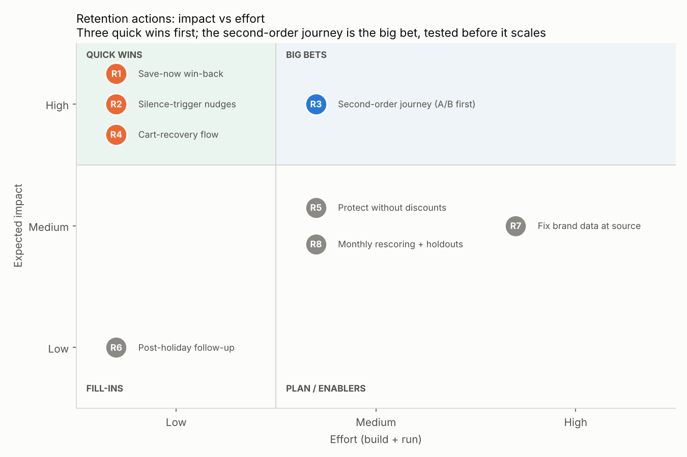

# Phase 9 — Recommendations

**Scripts:** [p9_recommendation_impacts.py](../src/p9_recommendation_impacts.py) (impact sizing) · [p9_impact_effort_chart.py](../src/p9_impact_effort_chart.py) · **Results:** [outputs/phase9/](../outputs/phase9/)
Money is in currency units. Every figure cites [key_numbers.csv](../key_numbers/key_numbers.csv). The impact estimates reuse the Phase 7 **ASSUMPTIONS** [K134] (contact 0.50, 10% discount, 40% gross margin) plus two marked below. The impact and effort ratings are judgements, explained in each row.

**The problem in one line:** 85.02% of Oct–Dec buyers did not return in Jan–Feb [K20], and 81.59% of all Oct–Dec buyers had bought only once [K24]. Those buyers brought 74.18% of Oct–Dec revenue [K23]. Revenue at risk for Mar–Apr 2020 is 3,508,675.24 as an upper bound (1.41× actual Jan–Feb revenue) [K130, K164].

## Prioritised actions

| # | Segment | Action | Owner | Expected impact | Effort | KPI (target) | Finding it rests on |
|---|---|---|---|---|---|---|---|
| **R1** | **Save now**: 12,735 buyers, high value with churn probability ≥ 0.80 [K132] | Personalised win-back (WhatsApp or push, with email as fallback), a 10% offer and a 10% random holdout | CRM / Retention | **+14,642.53 net** per 2-month wave at a 10% save rate (81,777.90 incremental revenue). Breaks even at a **4.69%** save rate [K135, K136]. | **Low**: the list already exists in `dim_customer`, and it is one journey | Save rate vs holdout (≥ 4.69%); Mar–Apr repeat rate | Phase 7 value × risk; Phase 6 calibrated scores (tiers within 1 pt of actual churn [K114]) |
| **R2** | **Automate**: 46,818 lower-value, high-risk buyers [K133], plus any buyer with no visit for about 30 days | Automated, **no-discount** nudges: replenishment reminder, back in stock, saved cart | Marketing automation | **+18,776.21 net** at a 2.5% save rate, with a break-even of only **0.50%** [K152]. Automations bring 2% of email sends but 30% of email revenue [B6]. | **Low**: standard flows | 30-day reactivation rate; unsubscribe rate (guardrail) | H4: churn is 92.93% after a silent last month vs 77.24% [K99] |
| **R3** | **New first-time buyers**: about 21,189 a month [K141] | Day-14 "complete your routine" / replenishment message. **Run a 3-arm A/B test first**: control, message only, and message + 10% offer. | CRM + Analytics | The largest structural lever. Single-order buyers churn at 90.37% vs 61.28% [K25, K26]. At +2 pp, that is **423.8 extra repeat buyers a month** and **+5,035.11 a month** from the automated message [K149]. | **Medium**: journey build plus a 13-week test [K150] | 60-day repeat rate (baseline 17.89% [K139]; MDE +2 pp) | H1: odds ratio 5.93 [K95]; Phase 3: 83.80% of second orders arrive within 60 days [K63] |
| **R4** | **Abandoned cart sessions**: 87.21% of cart sessions end without an order [K30] | Saved-cart reminder within hours, plus back-in-stock alerts. Do not treat cart *removals* as a churn alarm, because they signal engaged shoppers (H2). | Marketing automation / E-commerce | Each **1 pp** less abandonment means **9,872 more ordering sessions**, or **402,730.33** of revenue over Oct–Feb (80,546.07 a month) [K153]. The store is 16.99 pp above Baymard's average [K154], though the definitions differ. | **Low**: standard flow | Session cart abandonment (−1 pp a quarter); cart→purchase rate (22.75% [K29]) | Phase 4 funnel; H2: the no-removal decile churns at 98.35% [K97] |
| **R5** | **Protect**: 8,335 high-value, lower-risk buyers (avg churn 0.495; 318,102.22 at risk) [K145] | Loyalty perks: early access, samples, points. **Exclude them from discount campaigns.** | CRM / Loyalty | Avoids **23,149.22** of discounts per campaign [K151]. A blanket high-value discount only breaks even (+0.1%) [K137]. | **Medium**: perks need merchandising and finance sign-off | Protect churn rate; gross margin per order | Phase 7 strategy comparison; RFM Champions churn 28.67% [K86] |
| **R6** | **Holiday-acquired buyers**: 19,702 first-time buyers in Dec 2019 [K98] | January variant of the R3 journey, timed to the first replenishment cycle | CRM | If December buyers matched November's 60-day repeat rate: **784 extra repeat buyers**, about **33,101.26** at the average second-order value of 42.20 [K155, K147] | **Low**: a content variant of R3 | 60-day repeat rate, Dec cohort vs Nov cohort (gap 3.98 pp) | H3: +3.98 pp, h = 0.105 (small) [K98] |
| **R7** | **Catalogue**: brand missing on 40.38% of revenue [K41]; category_code missing on 98.29% of rows [K59] | Make brand and category mandatory at product upload, and backfill the top-selling product IDs | Data engineering / Catalogue | An enabler: unlocks brand-level cross-sell for the Grow quadrant (1,228 buyers [K133]) and personalised R1–R3 content | **High**: process change plus backfill | Share of revenue with brand and category populated | Phase 2 q06; data quality report |
| **R8** | **All scored buyers**: 69,116 [K117] | Monthly re-scoring, a tier calibration check, a dashboard refresh, and a permanent 10% holdout for every campaign | Analytics | Keeps the model's targeting power: the lowest-risk 20% hold 56.38% of stayers, lift 3.64× [K111]. Makes every ROI claim above measurable. | **Medium**: scheduled pipeline | Calibration within 1 pt per tier [K114]; incremental revenue vs holdout | Phase 6 limitations (one season, drift); Phase 8 dashboards |

**Order of work:**
- **Weeks 1–2:** launch R1, R2 and R4, the three quick wins. All use lists and flows that already exist.
- **Next:** start the R3 test, with R6 as its holiday variant.
- **Alongside:** run R5 as policy (no discounts for Protect) and R8 as routine.
- **Plan:** R7 with the catalogue team.

## What changes from Phase 7, and why
Phase 7 designed the second-order test with a 10% offer for every first-time buyer. Sizing it here shows that this is the wrong default.
- **The offer is costly.** The discount is also paid by the 17.89% who would have reordered anyway, so the offer arm needs a **+9.91 pp** uplift to break even [K148]. At the planned +2 pp detectable effect, it would lose **21,222.86 a month** [K149].
- **A message alone is cheap.** It breaks even at +2.96 pp with a 0.50 contact cost, or +0.59 pp if it is automated [K148]. The full grid is in [second_order_breakeven.csv](../outputs/phase9/second_order_breakeven.csv).
- **The revised test** has three arms of 6,011 buyers each (18,033 in total). It needs about 4 weeks of enrolment plus 9 weeks of follow-up, so 13 weeks [K150]. The MDE and power are unchanged.

## What not to do
- **Don't discount every high-value customer.** That only breaks even (+0.1% [K137]), because many of them were not leaving.
- **Don't fire churn alerts on cart removals.** Churners remove *less* (H2, r = −0.163 [K96]).
- **Don't judge the retention model on accuracy.** "Everyone churns" scores 85.02% and finds no one to save [K108].

## Assumptions added in this phase
- **R2 automated contact cost:** 0.10 per buyer, the low end of the Phase 7 contact grid.
- **R2 save rate:** 2.5%, the low end of the Phase 7 save-rate grid, because a no-discount nudge should be assumed to convert less.
- **R2 sensitivity:** R2 stays profitable down to a 0.50% save rate [K152], so the conclusion does not depend on the 2.5% choice.
- **R4 recovered revenue:** valued at the store AOV of 40.79 [K15]. It is revenue, not profit. A recovered session may also include orders that would have happened later anyway.
- **R6 impact:** counts only the second order (42.20 [K147]), which is a conservative lower bound.

## Limitations
- The impact figures are estimates for prioritisation, not forecasts. They come from one store, one season (2019–20) and stated assumptions. They become real only when measured against holdouts (R8).
- The 2025–26 context: rising acquisition costs (CAC up as much as 60% in five years [B4]) and a fast-growing Indian beauty e-commerce market [B8] make retention more valuable than in 2019. The *levels* here are this store's, though.

## Phase 9 summary
Eight actions, ranked by impact and effort:
- **Quick wins:** a personalised win-back for the 12,735 Save-now buyers (+14,642.53 per wave, break-even 4.69%), no-discount automated nudges for 46,818 low-value, high-risk buyers (break-even save rate 0.50%), and a cart-recovery flow (each 1 pp = 402,730.33 over five months).
- **Big bet:** the second-order journey for first-time buyers. Sizing it changed the Phase 7 test design: a blanket 10% offer needs a +9.91 pp uplift to pay back, so the test now adds a message-only arm.
- **Policy and enablers:** no discounts for Protect buyers (saves 23,149.22 per campaign), a post-holiday follow-up, brand data fixes and monthly re-scoring with holdouts.
