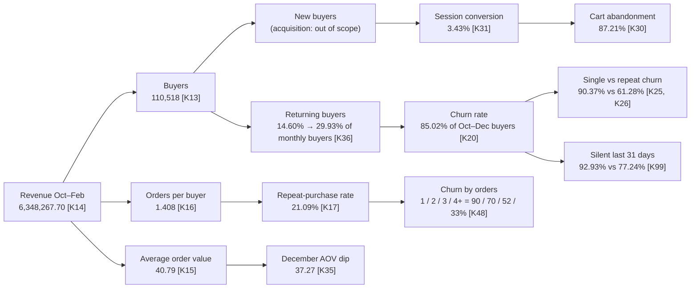

# KPI Tree and Stakeholder Question Map

This page is a one-page business-analyst view of the project. It shows how revenue breaks down into levers, which lever each analysis moved, and which decision every stakeholder question leads to. Figures cite [key_numbers.csv](../key_numbers/key_numbers.csv). Money is in the dataset's currency units.

## 1. KPI tree: where revenue comes from

Revenue = buyers × orders per buyer × average order value.
Check: 110,518 × 1.408 × 40.79 ≈ 6.35M, which matches the total of 6,348,267.70 [K13, K16, K15, K14].

**How to read it:**
- The project works on the **returning buyers** and **orders per buyer** branches. That is the retention side of revenue.
- Acquisition (new buyers) appears only through the funnel: session conversion and cart abandonment.
- The biggest leak is churn after the first order. 74.18% of Oct–Dec revenue came from buyers who never returned [K23].

## 2. Stakeholder question → metric → decision

| Stakeholder | Question | Metric (source) | Finding | Decision it drives |
|---|---|---|---|---|
| CEO / Leadership | How big is churn, and what does it cost? | Churn rate [K20]; revenue share from churned buyers [K23] | 85.02% churn; they brought 74.18% of Oct–Dec revenue | Fund retention ahead of extra acquisition spend |
| CRM / Retention | Who do we contact first? | Churn probability × predicted CLV (value × risk quadrant) [K132] | 12,735 Save-now buyers, average churn probability 0.888 | Personalised win-back for Save now only (R1) |
| Finance | Will the campaign pay back? | ROI, net profit, break-even save rate [K135, K136] | Projected +81.0%, 14,642.53 net per wave; break-even 4.69% | Approve the pilot with a 10% holdout |
| Marketing automation | What about everyone else at risk? | Automate quadrant economics [K152] | No-discount nudges break even at a 0.50% save rate | Automated nudges, no discount (R2) |
| E-commerce / Product | Where does the funnel leak? | Session cart abandonment [K30]; value of 1 pp [K153] | 87.21% abandonment; each 1 pp less = 402,730.33 over five months | Cart-recovery flow (R4) |
| CRM + Analytics | Should every new buyer get 10% off? | Break-even uplift [K148]; A/B sizing [K150] | A blanket offer needs +9.91 pp to pay back | 3-arm A/B test: control, message only, message + offer (R3) |
| Loyalty | Should loyal buyers get discounts? | Protect quadrant churn [K145]; discount avoided [K151] | Average churn probability 0.495; 23,149.22 of discount avoided | Perks and early access, no discounts (R5) |

## 3. KPI definitions used by every dashboard

| KPI | Definition | Grain |
|---|---|---|
| Churn rate | Oct–Dec 2019 buyers with no order in Jan–Feb 2020 ÷ Oct–Dec buyers | Customer |
| Repeat-purchase rate | Buyers with 2+ orders ÷ all buyers, Oct–Feb | Customer |
| AOV | Revenue ÷ orders | Order |
| Cart abandonment | Sessions with a cart add and no purchase ÷ sessions with a cart add | Session |
| Revenue at risk (upper bound) | Σ churn probability × value if retained; 1.41× actual Jan–Feb revenue, so used for ranking, not forecasting [K130, K164] | Customer |
| Campaign ROI | (margin × incremental revenue − cost) ÷ cost | Campaign |

Full DAX versions are in [POWERBI_BUILD_GUIDE.md](../dashboard/powerbi/POWERBI_BUILD_GUIDE.md), and the business-framing definitions are in [01_business_framing.md](01_business_framing.md).
